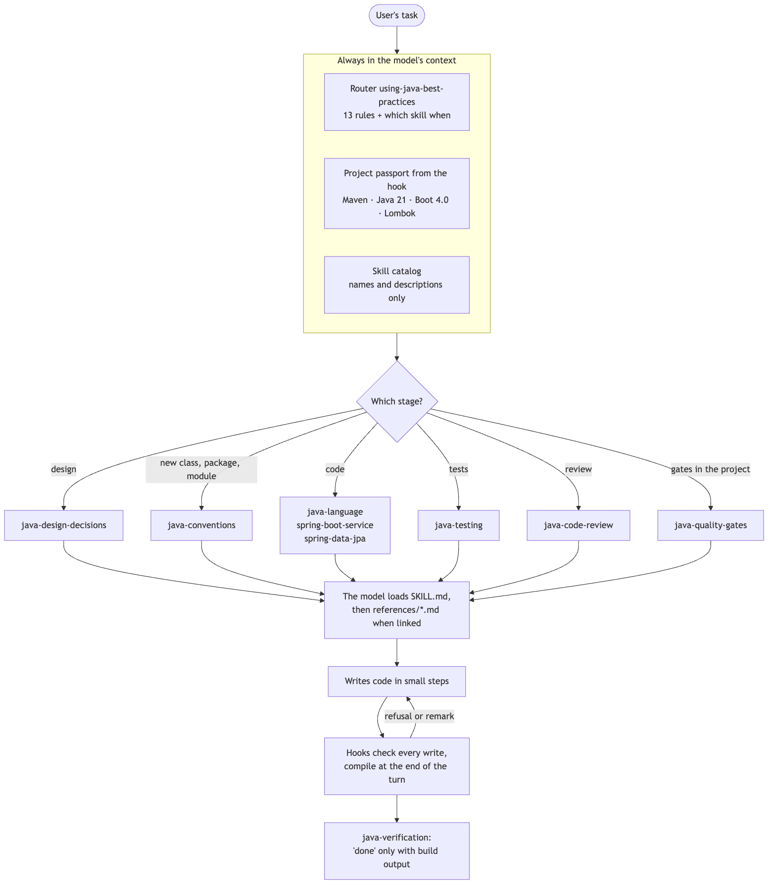

# forbxpg-java

Java / Spring Boot best practices for coding agents — **ten Agent Skills plus hooks that
enforce the rules even when the model forgets them.**

Claude Code · GigaCode · Codex — Windows, Linux, macOS — Node ≥ 20, no other runtime.

[Русская версия](README.ru.md) · [Installation](docs/en/installation.md) ·
[How it works](docs/en/how-it-works.md) · [Configuration](docs/en/configuration.md)

## Why

Prose rules are advice. A model with a long session, an auto-compacted context or a small
attention span drops them. forbxpg-java puts the rule next to the action:

- **before a write**, a hook blocks new hard violations and tells the model how to fix
  them;
- **after a write**, the model gets the soft findings of that edit and the rules for the
  file's role (controller, entity, mapper…);
- **at the end of a turn**, the hook compiles what changed and stops the model on its own
  compile errors;
- **after compaction**, the core rules come back once.

The rules come from the team's Maven / Spring Boot 4 projects (Lombok, MapStruct,
Liquibase, layered packages) and from an analysis of ten public Java skill collections.

## How the skills work



1. **Always in context:** the router `using-java-best-practices` (13 rules and a
   "which skill when" table), the project passport the hook reads from `pom.xml`, and the
   skill catalog. Every other skill costs only its name and description, about 100
   tokens each.
2. **A skill loads for the task.** The router names the skill for the stage of work:
   design, a new class, code, tests, review or gates. The model loads its `SKILL.md` and
   reads the long `references/` only when a link points there, so the context holds only
   what the task needs.
3. **Hooks check the result.** Every file write passes a hook: a new hard violation is
   refused with a ready fix, a soft one comes back as a remark. At the end of the turn the
   hook compiles what changed, and the model fixes its own errors.
4. **"Done" needs proof:** `java-verification` makes the model quote the build and test
   output.

## Skills

| Skill | For |
|---|---|
| `using-java-best-practices` | always loaded: passport, 13 core rules, which skill when |
| `java-design-decisions` | before code: the API, data, integration, testing and rollout decisions to settle (works with any design process, e.g. a grillspec grill) |
| `java-conventions` | layout, packages, naming, Lombok by role, DTO records, MapStruct, configuration |
| `java-language` | modern Java 21 / 25: records, sealed types, patterns, exceptions, concurrency |
| `spring-boot-service` | controllers, validation, ProblemDetail, transactions and proxies, HTTP clients, `@Async` / `@Scheduled`, Boot 3 vs 4 |
| `spring-data-jpa` | entities, repositories, N+1, locking, Liquibase |
| `java-testing` | JUnit 5, AssertJ, Mockito, slices on H2, Testcontainers when Docker is there |
| `java-code-review` | review by area: correctness, concurrency, performance, security, API, tests |
| `java-verification` | the right `mvn` command and a Verification block before "done" |
| `java-quality-gates` | ArchUnit `CodeRulesTest` (13 rules), freezing legacy violations, Enforcer, JaCoCo |

## Hooks

| When | What |
|---|---|
| Session start | project passport: `Maven · Java 21 · Boot 4.1 · Lombok · MapStruct · Liquibase` |
| Every prompt (GigaCode) | a ≤ 60-token anchor: passport + three rules |
| Before a write | blocks **new** J1–J6 (field `@Autowired`, `javax.*` on Boot 3+, `System.out`, `@MockBean` on Boot 4, JUnit 4, new `@Disabled`), G1–G2 (applied Liquibase changeset, gate configs), S1–S2 (`push --force`, `reset --hard`, `clean -f`, gates with `-DskipTests`) |
| After a write | new W1–W12 findings (`@Data` on `@Entity`, eager `@ManyToOne`, ordinal enums, `*Impl`, log concatenation…) + role rules once per session |
| After compaction | passport, ten core rules, "re-read your plan" — once |
| End of turn | compile changed modules (`-o -q`), block only on errors in the session's own files, at most twice; warn once at 70 % context |

Only violations an edit **introduces** are blocked: legacy code is never in the way.

## Install

Clone the repository (or unpack a release), then:

```bash
# for you, in every project (the agent's own CLI registers this folder; git pull updates it)
node install.mjs --agent gigacode --scope user
node install.mjs --agent claude   --scope user

# into one repository (.gigacode/ or .claude/), committed so the whole team gets it
node install.mjs --agent gigacode --scope project --project ../my-service
node install.mjs --agent claude   --scope project --project ../my-service

# later: update (keeps files the team edited), or remove exactly what was installed
node install.mjs --agent gigacode --scope project --project ../my-service --update
node install.mjs --agent gigacode --scope project --project ../my-service --uninstall
```

`--dry-run` shows the plan without changing anything. Skills only, without hooks:
`npx skills add forbxpg/forbxpg-java-best-practices-skill`.

Codex and details: [docs/en/installation.md](docs/en/installation.md).

## Development

```bash
node --test                       # hooks and scripts, 100+ tests
node scripts/validate-skills.mjs   # Agent Skills spec, GigaCode name rule, sizes, routing cases
node scripts/check-tokens.mjs      # always-on token budget
ROUTING_API_KEY=... node scripts/eval-routing.mjs --endpoint <url> --model <id>
```

`tests/fixtures/gates-project` plants one violation per ArchUnit rule:
`mvn -B -ntp test` there must fail with exactly 13 failures.

## License

MIT. Ideas and some text adapted from other MIT / Apache-2.0 projects — see [NOTICE](NOTICE).
