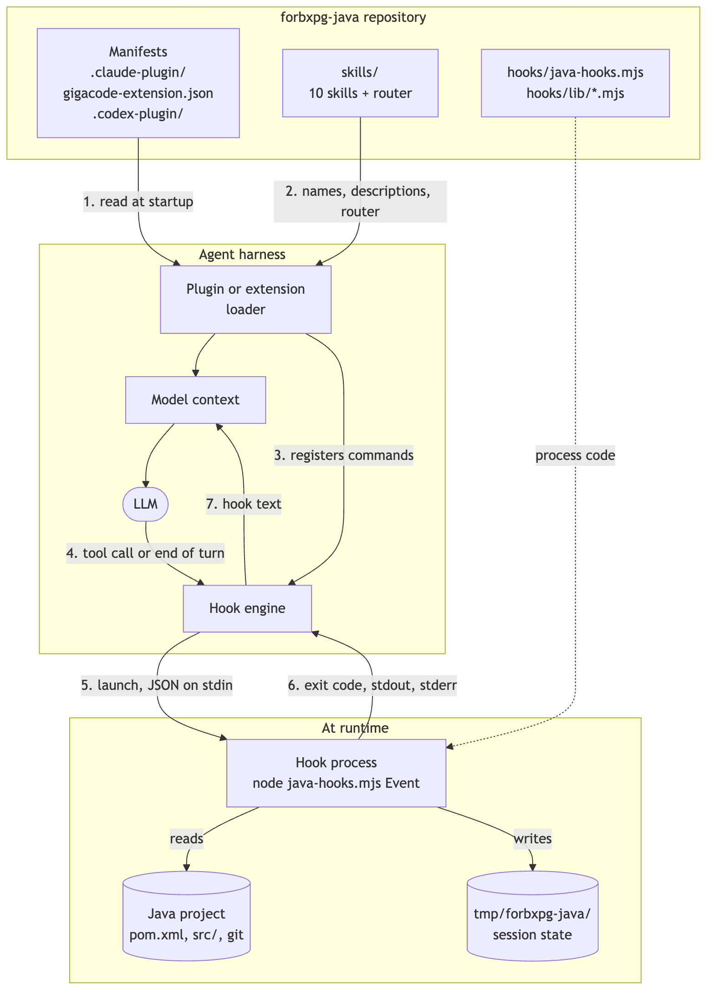
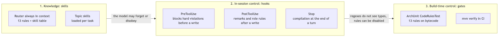

# 01. Overview

forbxpg-java is a set of Java / Spring Boot rules for agents that works in three
harnesses: Claude Code, GigaCode and Codex. It consists of two halves:

- **skills** — texts that the model reads and follows when it writes code;
- **hooks** — a small Node program that the harness runs at key moments of the agent's
  work and that checks what the model has done.

Skills explain how things should be done. Hooks make sure they are done that way.

## Glossary

| Term | What it means here |
|---|---|
| **Harness** | The agent program around the model: Claude Code, GigaCode, Codex. It exposes tools to the model (file write, shell), executes them and runs hooks |
| **Model** | The LLM inside the harness. It sees only the text in its context |
| **Hook** | A command that the harness runs on an event (session start, file write, end of turn). For us it is always `node java-hooks.mjs <Event> --harness <name>` |
| **Event** | A point in the lifecycle: `SessionStart`, `UserPromptSubmit`, `PreToolUse`, `PostToolUse`, `PostCompact`, `Stop` |
| **Skill** | A `skills/<name>/` folder with a `SKILL.md`: frontmatter (name and description) + text. The model loads it when the task matches the description |
| **Router** | The `using-java-best-practices` skill: 13 rules and a "which skill when" table. Always in context |
| **Passport** | A line about the project's stack that the hook reads from `pom.xml`: `Maven · Java 21 · Boot 4.0 · Lombok` |
| **Hard rule** | J1–J6, G1–G2, S1–S2. A violation blocks the write or the command |
| **Soft rule** | W1–W12. A violation reaches the model as a remark after the write |
| **File role** | controller, service, entity and so on. On the first write of a file with a given role, the model receives that role's short rules |

## What the repository consists of

| Path | What it is |
|---|---|
| `skills/` | 10 skills. `using-java-best-practices` is the router |
| `hooks/java-hooks.mjs` | The single entry point for all hooks |
| `hooks/lib/*.mjs` | Logic: events (`pre`, `post`, `session`, `stop`), rules (`rules`, `roles`, `guard`), project (`passport`, `io`, `config`), state (`state`), Maven (`maven`) |
| `hooks/hooks.json` | Hook registration for the Claude Code plugin |
| `hooks/hooks-codex.json` | Hook registration for the Codex plugin |
| `gigacode-extension.json` | GigaCode extension manifest: router, skills and hooks |
| `.claude-plugin/` | Claude Code plugin and marketplace manifest |
| `.codex-plugin/plugin.json` | Codex plugin manifest |
| `install.mjs`, `installer/` | Installer: user scope through the agent's CLI, project scope by copying into the repository |
| `skills/java-quality-gates/assets/CodeRulesTest.java` | An ArchUnit test with 13 rules; the agent adds it to the project on request |
| `scripts/` | Skill checks, token budget, routing evaluation, diagram rendering |
| `tests/` | `node --test`: 150+ tests for the hooks and the installer, fixtures, a Maven project for the gates |

There are no dependencies: only Node ≥ 20 and its standard library. This is deliberate,
so that the hooks work on a locked-down machine without `npm install` and behave the same
on Windows (`cmd`), Linux and macOS.

## Three defense layers

1. **Knowledge (skills).** The model knows the rules because the router is always in
   context and the topic skill is loaded for the task. This is not enough: in a long
   session the model forgets, after context compaction it loses details, and a weak model
   simply makes mistakes.
2. **In-session control (hooks).** The harness itself runs a check on every write and at
   the end of every turn. The model cannot "forget" to call the hook, because it is not
   the model that calls it. But the hook sees only text, without types, and a rule can be
   disabled in `forbxpg-java.json`.
3. **Build-time control (gates).** An ArchUnit test in the project checks the bytecode
   during `mvn test` / `verify` and fails CI. Disabling a hook does not get around it, and
   it sees types and the relationships between classes. It is installed by the
   `java-quality-gates` skill.

Each layer catches what the previous one missed.

## What the hooks do during one session

In short; details are in [02](02-hooks-explained.md) and [03](03-hook-events.md):

| When | What the model sees |
|---|---|
| Session start | The project passport; in Claude Code and Codex also the router text |
| Every message (GigaCode) | The anchor: passport + three rules (the ones the model broke come first), ≤ 60 tokens |
| Before a file write | A refusal if the write introduces a **new** hard violation |
| After a write | New soft remarks and, the first time in the session, the rules for the file's role |
| After context compaction | Once, a recovery block of ≤ 500 tokens, with the rules the model broke |
| End of turn | If the session changed `.java` files, a compilation; the model cannot finish while its own errors remain |

Outside a Maven project the hooks do nothing: they exit with code 0 and no output.
