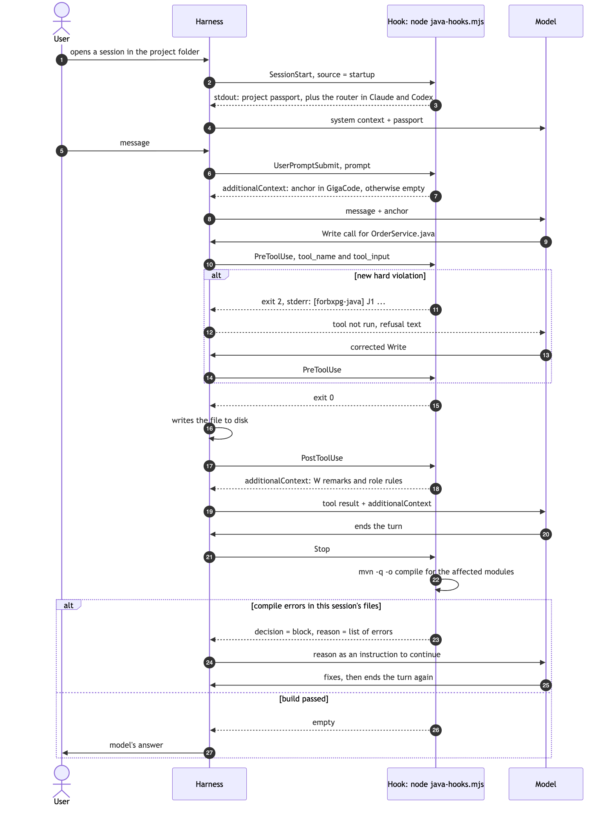
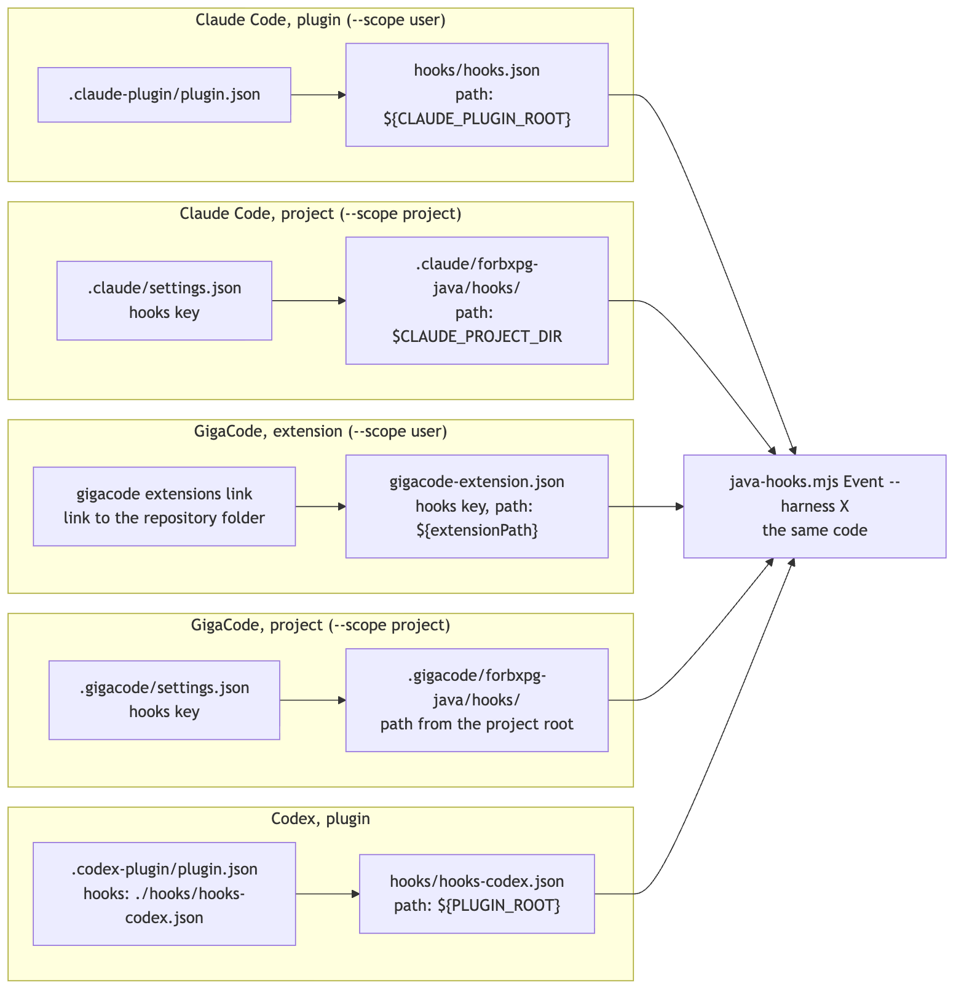
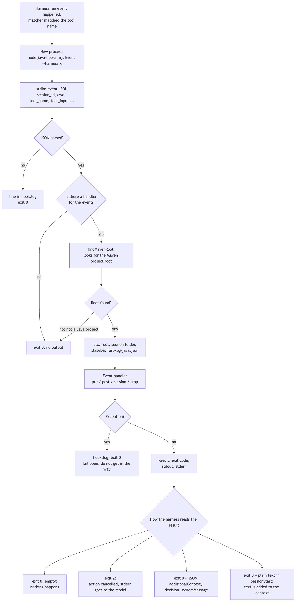
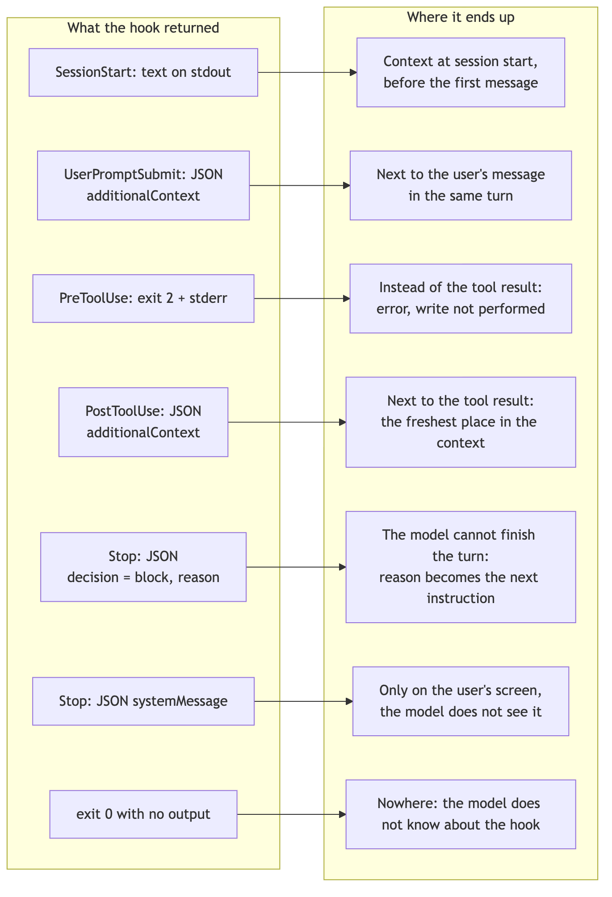
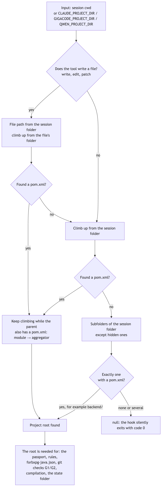

# 02. Hooks: what they are and how they work

## What a hook is

A hook is an **operating system command** that the harness itself runs at a specific
moment of the agent's work. It is not a function inside the model, and it is not a tool
that the model may or may not call. The model knows nothing about hooks at all until a
hook returns some text.

Each harness has a list of lifecycle **events**. When an event happens, the harness looks
at its settings, finds the commands subscribed to that event, runs each of them as a
separate process and waits for the result. Based on the result, it decides whether to
continue the action and what to add to the model's context.

forbxpg-java subscribes the same command to all events:

```text
node <hooks folder>/java-hooks.mjs <Event> --harness <claude|gigacode|codex>
```

`<Event>` is the event name; `--harness` tells the code which format to answer in and
which quirks to take into account.

## Why hooks, and not just rule text

| | Rule in a skill | Rule in a hook |
|---|---|---|
| Who runs it | The model decides on its own whether to read it | The harness, always, on every event |
| Long session | Gets lost in the context | Checks every write the same way |
| After context compaction | May disappear | The hook code is not in the context and is not compacted |
| Weak model | Reads it and breaks it anyway | The violation never reaches the disk |
| Token cost | The whole rule text, always | Zero while there is no violation |
| What it sees | Everything the model understood | Only the text of the file and the command, without types |

A hook is deterministic: the same edit always gets the same answer. That is why the hard
rules (things that break the build, the data or the git history) live in hooks, while
the skills explain why the rule exists and how to write the code correctly the first
time.

## Lifecycle of one session



What matters here:

- **A hook is a separate process for each event.** Nothing stays in memory between
  calls. Everything that has to be remembered (whether there was a compaction, which
  files changed) the hook writes to the OS temporary folder
  ([05](05-state-config-passport.md)).
- **The harness waits for the hook.** Until `PreToolUse` answers, the file is not
  written. Until `Stop` answers, the turn is not over. That is why hooks have timeouts:
  10 s for everything except `Stop` (200 s, because it compiles).
- **The model does not see that the hook was called** if the hook returned nothing. It
  sees only the text that the hook returned, in the place where the harness put it.

## Where hooks are stored

A hook is recorded in two places: the **registration** (which event → which command) and
the **code** (`java-hooks.mjs` + `lib/`). Where each of them lives depends on the harness
and on the installation method.



| Installation | Registration | Code | How the command finds the code |
|---|---|---|---|
| Claude Code, plugin | `hooks/hooks.json` in the plugin folder | `hooks/` in the plugin folder | `${CLAUDE_PLUGIN_ROOT}` — the harness substitutes the plugin path |
| Claude Code, project | the `hooks` key in `.claude/settings.json` | `.claude/forbxpg-java/hooks/` | `$CLAUDE_PROJECT_DIR` — the path to the project root |
| GigaCode, extension | the `hooks` key in `gigacode-extension.json` | `hooks/` in the repository folder (linked by `extensions link`) | `${extensionPath}` and `${/}` — the extension path and the OS path separator |
| GigaCode, project | the `hooks` key in `.gigacode/settings.json` | `.gigacode/forbxpg-java/hooks/` | a path relative to the project root: GigaCode runs the hook from the root |
| Codex, plugin | `hooks/hooks-codex.json` (referenced from `.codex-plugin/plugin.json`) | `hooks/` in the plugin folder | `${PLUGIN_ROOT}` |

A single registration entry looks like this (Claude Code, `hooks/hooks.json`):

```json
"PreToolUse": [
  {
    "matcher": "Write|Edit|MultiEdit|Bash",
    "hooks": [
      {
        "type": "command",
        "command": "node \"${CLAUDE_PLUGIN_ROOT}/hooks/java-hooks.mjs\" PreToolUse --harness claude",
        "timeout": 10
      }
    ]
  }
]
```

- `matcher` is a regex over the tool name. The write hook does not run when the model
  reads a file or searches the code: an extra Node process is not needed.
- `timeout` is in seconds in Claude Code and Codex, and in milliseconds in GigaCode
  (`10000`).
- Several hooks on the same event (for example, your own and ours) work independently.
  When installing into a project, the installer **adds** its entries next to existing
  ones instead of replacing them ([07](07-installation.md)).

Harnesses read the registration **at session start**. After installing or updating the
hooks, open a new session.

### Hook approval

A hook is an arbitrary command on your machine, so harnesses are careful:

- **Claude Code**: plugin hooks work once the plugin is installed. Hooks from the
  project's `.claude/settings.json` work in a trusted folder; if the hooks are changed in
  the middle of a session, Claude Code shows them for review in `/hooks`.
- **GigaCode**: hooks are enabled by default; the switch is `"disableAllHooks": true` in
  `~/.gigacode/settings.json`. In non-interactive mode (`gigacode -p`) project hooks run
  without asking.
- **Codex**: plugin hooks run only after you explicitly trust them in `/hooks`.

## How the hook talks to the harness

The protocol is the same in all three harnesses (GigaCode and Codex follow the Claude Code
format):

- **input** — the event JSON on **stdin**;
- **output** — the **exit code**, **stdout** and **stderr**.



### Input: what arrives on stdin

An example of `PreToolUse` from Claude Code when the model writes a file:

```json
{
  "session_id": "s-claude",
  "cwd": "/proj",
  "hook_event_name": "PreToolUse",
  "tool_name": "Write",
  "tool_input": { "file_path": "/proj/src/main/java/a/Foo.java", "content": "class Foo {}\n" },
  "tool_use_id": "toolu_c1"
}
```

The same from GigaCode for an edit:

```json
{
  "session_id": "s-giga",
  "cwd": "C:\\proj",
  "hook_event_name": "PreToolUse",
  "tool_name": "edit",
  "tool_input": { "file_path": "C:\\proj\\src\\main\\java\\a\\Foo.java", "old_string": "class Foo {}", "new_string": "class Foo { int x; }" },
  "tool_use_id": "toolu_g2"
}
```

Codex edits files through `apply_patch`, and `tool_input` contains the patch text:

```json
{ "tool_name": "apply_patch", "tool_input": { "input": "*** Begin Patch\n*** Update File: src/main/java/a/Foo.java\n*** End Patch" } }
```

Tool and field names differ between harnesses. `normalizeTool` (`hooks/lib/io.mjs`)
reduces them to five kinds: `write`, `edit`, `shell`, `patch`, `other`. From there on, the
code does not know which harness called it.

Other events bring their own fields: `source` in `SessionStart` (`startup`, `resume`,
`clear`, `compact`), `prompt` in `UserPromptSubmit`, `stop_hook_active` and (GigaCode
only) `context_usage` in `Stop`.

### Output: what the hook can answer

| Answer | Meaning for the harness | Where we use it |
|---|---|---|
| exit 0, empty | Everything is fine, add nothing | Most calls |
| exit 2 + text on stderr | **Cancel the action**, give stderr to the model | `PreToolUse`: a hard violation |
| exit 0 + JSON `hookSpecificOutput.additionalContext` | Add the text to the model's context | `UserPromptSubmit`, `PostToolUse` |
| exit 0 + JSON `{"decision": "block", "reason": ...}` | Do not let the model finish the turn; `reason` says what to do | `Stop`: the session's own compile errors, handoff |
| exit 0 + JSON `{"systemMessage": ...}` | Show to the **user**, do not give to the model | `Stop`: the build could not be checked |
| exit 0 + plain text | For `SessionStart`: add to the context | Passport and router |
| any other code | Hook error, the action continues | Never happens for us: internal errors → exit 0 |

**Fail open.** If something breaks inside the hook (malformed JSON, an exception), it
writes a line to `hook.log` and exits with code 0. A broken hook never gets in the way of
work: it is better to miss a violation than to block all work because of a bug in a
check.

## When does the agent "understand" a hook

The model learns about a hook **only from the text that the harness put into its
context**. Where exactly the text ends up depends on the event and the kind of answer:



In a live run in Claude Code it looks like this.

**Refusal before a write.** The model called `Write` with an `@Autowired` field. Instead
of the tool result it received:

```text
PreToolUse:Write hook error: [node ".../java-hooks.mjs" PreToolUse --harness claude]:
[forbxpg-java] J1: @Autowired on a field in production code (line 10). Fix: make the field
private final and inject it through the constructor with Lombok @RequiredArgsConstructor.
Example: @RequiredArgsConstructor class OrderService { private final OrderRepository orders; }.
If the user explicitly asked for this, stop and ask the user ... do not retry or work around it
```

The file is not written. The model reads what is wrong, how to fix it and the example,
and writes the file again. In GigaCode the same refusal arrives as
`Tool "edit" was not run: [forbxpg-java] J1: ...`.

**Remark after a write.** The write went through, and next to the tool result the model
sees `additionalContext`:

```text
[forbxpg-java] W1: @Data / @EqualsAndHashCode / @ToString on an @Entity: ... (line 11).
Fix: use @Getter @Setter @NoArgsConstructor(access = AccessLevel.PROTECTED) ...
[forbxpg-java] entity rules:
- @Getter @Setter @NoArgsConstructor(access = PROTECTED); never @Data, @EqualsAndHashCode, @ToString.
- equals/hashCode on the id; @ManyToOne/@OneToOne(fetch = LAZY); @Enumerated(EnumType.STRING).
- Schema changes go in a new Liquibase changeset, never ddl-auto.
```

This is the freshest place in the context: the model sees the remark right after its own
edit and usually fixes it in the next step.

**Block at the end of a turn.** The model wants to finish, but `Stop` returned
`decision: block`. The harness does not give the answer to the user; instead it passes
`reason` to the model:

```text
[forbxpg-java] The code does not compile:
- src/main/java/com/example/service/OrderService.java:14 cannot find symbol
Fix these errors before you finish.
```

The model keeps working, fixes the errors and tries to finish the turn again.

### Why a refusal is exit 2

In Claude Code, `PreToolUse` can return a soft hint through `additionalContext` or
`permissionDecision`. But in GigaCode, `additionalContext` from `PreToolUse` **never
reaches** the model, while a refusal with exit code 2 and text on stderr does (hook probe
on GigaCode 26.11.141). To make the behavior the same everywhere, all hard rules answer
with code 2.

### Why every hard message ends with "stop and ask"

A model that a hook has refused may try to get around it: write the file through the
shell, or split the edit into parts. That is why every hard message ends with the
sentence: if the user explicitly asked for this, stop and ask them, do not retry and do
not work around it. In a live run the model did exactly that: given the prompt "add a
field with `@Autowired`", it did not try to get around J1 but offered the user a choice —
constructor injection or disabling the rule in `forbxpg-java.json`.

## What the hook does on every call

The common part is the same for all events (`hooks/java-hooks.mjs`):

1. Read stdin and parse the JSON. If that fails — a line in `hook.log`, exit 0.
2. Find the handler for the event. Unknown event — exit 0.
3. Find the **Maven project root** (`findMavenRoot`, see below). If it is not found —
   exit 0: this is not a Java project, and the hook has nothing to do here.
4. Build the context: the root, the session folder (for relative paths), the state
   folder, the `forbxpg-java.json` settings.
5. Call the event handler and return its answer. On an exception — `hook.log`, exit 0.

### How the hook finds the project

The harness reports the session folder (`cwd` in the input, or the `CLAUDE_PROJECT_DIR`,
`GIGACODE_PROJECT_DIR`, `QWEN_PROJECT_DIR` variables). But the session may be opened
somewhere other than the root of the Maven project: in `src/`, in a module, or in the
root of a git repository where the Maven project lives in `backend/`. That is why the
root is looked up as follows:



- First upward from the **file being written**: the rule applies to the project that the
  file belongs to.
- Then upward from the **session folder**.
- The climb does not stop at the first `pom.xml`: from the `core/` module it goes up to
  the aggregator if the parent also has a `pom.xml`.
- If nothing is found upward, the hook looks at subfolders: if exactly one has a
  `pom.xml`, that is the root.
- If there are two or more Maven subfolders and there is no file (session start, end of
  turn, shell), the hook stays silent instead of guessing.

The hook resolves relative file paths from `tool_input` **against the session folder**,
not against the found root: that is how the harness itself understands them.

## Hook code: module map

| Module | Responsible for |
|---|---|
| `java-hooks.mjs` | Entry point: stdin, root lookup, handler selection, fail open |
| `lib/io.mjs` | Session folder, Maven root lookup, `normalizeTool` for the three harnesses |
| `lib/session.mjs` | `SessionStart`, `PostCompact`, `UserPromptSubmit` |
| `lib/pre.mjs` | `PreToolUse`: build the file as it will be after the write, find new hard violations |
| `lib/post.mjs` | `PostToolUse`: new remarks, role rules, marking changed files |
| `lib/stop.mjs` | `Stop`: context warning, compilation, error parsing |
| `lib/rules.mjs` | The J / W rule catalog, violation search, "before / after" comparison, message text |
| `lib/guard.mjs` | Rules that are not about Java: S1, S2 (shell) and G1, G2 (protected files, through git) |
| `lib/roles.mjs` | The file role and its short rules |
| `lib/passport.mjs` | The project passport from `pom.xml`, cache |
| `lib/anchor-text.mjs` | Texts of the anchor and the recovery block |
| `lib/edit.mjs` | Apply `old_string → new_string` the way the tool will |
| `lib/javatext.mjs` | Replace comments and strings with spaces, preserving positions |
| `lib/maven.mjs` | Compile command, running it with a timeout, parsing `javac` errors |
| `lib/state.mjs` | Session state in the temporary folder, `hook.log` |
| `lib/config.mjs` | The project's `forbxpg-java.json` and `~/.forbxpg-java.json` |

Next: [03. Events in order](03-hook-events.md).
