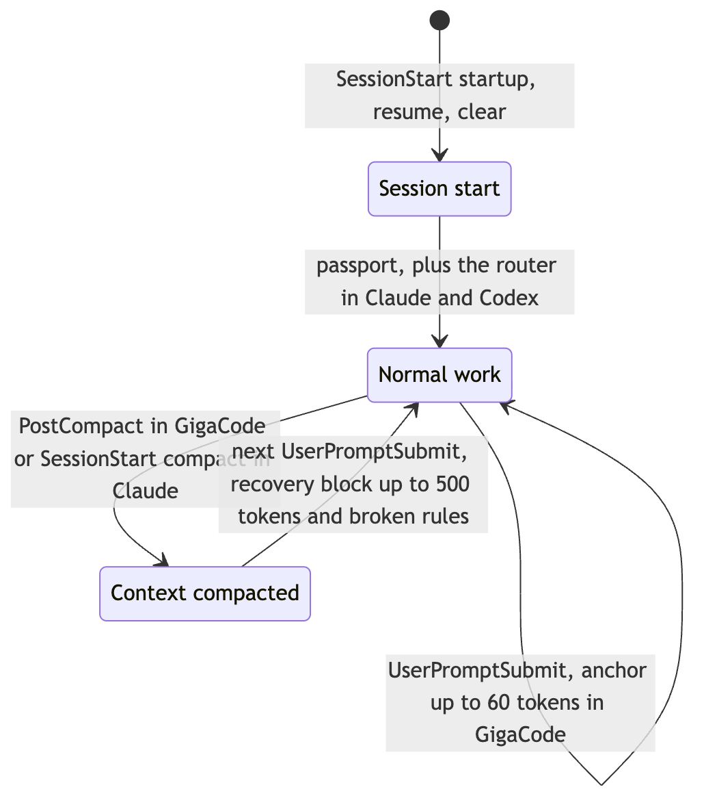
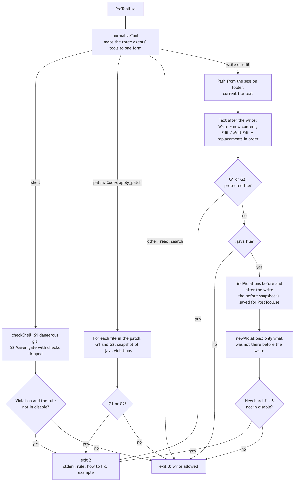
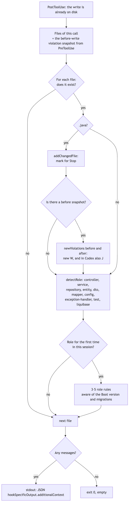
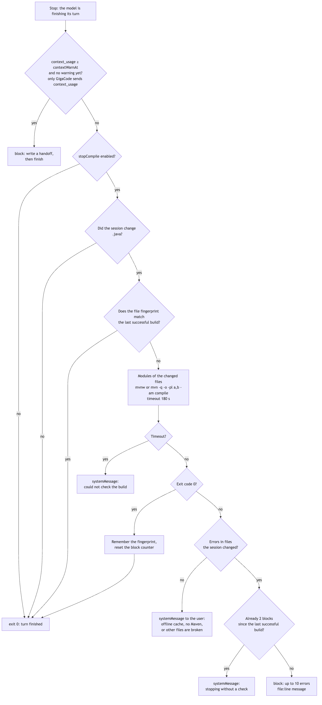

# 03. Events in order

Which events are subscribed to what:

| Event | Claude Code | GigaCode | Codex | Timeout | Handler |
|---|---|---|---|---|---|
| `SessionStart` | yes (`startup\|resume\|clear\|compact`) | yes | yes | 10 s | `session.mjs` |
| `UserPromptSubmit` | yes | yes | yes | 10 s | `session.mjs` |
| `PreToolUse` | `Write\|Edit\|MultiEdit\|Bash` | `write_file\|edit\|replace\|run_shell_command` | `apply_patch\|Edit\|Write\|Bash\|exec_command` | 10 s | `pre.mjs` |
| `PostToolUse` | `Write\|Edit\|MultiEdit` | `write_file\|edit\|replace` | `apply_patch\|Edit\|Write` | 10 s | `post.mjs` |
| `PostCompact` | — (compaction is visible through `SessionStart compact`) | yes | — | 10 s | `session.mjs` |
| `Stop` | yes | yes | yes | 200 s | `stop.mjs` |

`PostToolUse` is not subscribed to shell tools: a shell command does not write `.java`
files through a write tool, and an extra Node process for every command is not needed.

## SessionStart: passport and router

**When:** a new session is opened, an old one is resumed (`resume`) or cleared (`clear`),
and in Claude Code and Codex also after context compaction (`compact`).

**What it does:**

1. If `source = compact`, it sets the `compacted` flag so that the next message gets the
   recovery block.
2. Reads the project passport ([05](05-state-config-passport.md)).
3. Prints the passport line to stdout:

   ```text
   [forbxpg-java] Maven · Java 21 · Boot 4.0 · Lombok
   ```

4. In Claude Code and Codex, it adds the **router text** without frontmatter after the
   passport. In GigaCode the router is not printed: the harness itself has already loaded
   it through `contextFileName` in the extension manifest or through an `@` import in
   `GIGACODE.md`.

The hook looks for the router in two places: next to itself in the repository
(`hooks/lib → skills/using-java-best-practices`) and in a project installation
(`.claude/forbxpg-java/hooks/lib → .claude/skills/...`).

**Result:** from the first message, the model knows the project's stack and the 13 rules.

## UserPromptSubmit: anchor and recovery

**When:** the user has sent a message, before the model sees it.



**What it does:**

1. An empty message (continuation without text) — nothing.
2. If the `compacted` flag is set, it clears the flag and returns the **recovery block**
   (≤ 500 tokens): the passport, the ten main rules adjusted to the stack (MapStruct or
   factories, Liquibase or Flyway, `@MockitoBean` or `@MockBean`), up to five rules broken
   in this session with the full "how to fix", and "re-read the plan and notes":

   ```text
   Rules you broke in this session:
   - J1: no @Autowired fields; use constructors. Fix: make the field private final and inject it ...
   - W1: no @Data on @Entity. Fix: use @Getter @Setter @NoArgsConstructor(access = AccessLevel.PROTECTED) ...
   ```

3. Otherwise, the **adaptive anchor** (≤ 60 tokens), if it is enabled: the passport and
   three rules. The rules are chosen in this order:
   1. rules broken in this session (blocks before a write and remarks after it), most
      recent first — the last three **distinct** ones; an old one drops out only when a
      new one arrives;
   2. rules for the roles of files the session has touched, most recent first;
   3. three default rules;
   4. identical text is taken only once (the `entity` role and W1 both say "no @Data on
      @Entity").

   In a new session the anchor looks like this:

   ```text
   [forbxpg-java] Maven · Java 21 · Boot 4.0 · Lombok
   Rules: load java-conventions before new classes · no @Data on @Entity · run mvn -q compile before saying done
   ```

   After the model got W1 on an entity and then a J1 block on a service:

   ```text
   [forbxpg-java] Maven · Java 21 · Boot 4.0 · Lombok
   Rules: no @Autowired fields; use constructors · no @Data on @Entity · @Transactional on public service methods
   ```

   This way the anchor reminds the model of the things it has already got wrong, rather
   than of general rules. The short texts (≤ 40 characters) are the `short` field of each
   rule in `rules.mjs` and `ROLE_SHORT` in `roles.mjs`.

   By default the anchor is enabled in GigaCode and disabled in Claude Code and Codex. The
   `anchor` key in `forbxpg-java.json` changes this ([05](05-state-config-passport.md)).

**Answer:** JSON `hookSpecificOutput.additionalContext`. The harness attaches the text to
the user's message in the same turn.

**Why the anchor is short:** it arrives with **every** message, and GigaCode does not
de-duplicate it. Over a long session, 60 tokens per message add up to thousands.

## PostCompact: compaction flag

**When:** GigaCode only, after automatic context compaction.

**What it does:** sets the `compacted` flag. It prints nothing itself. The recovery block
goes out with the user's next message (see above): that way it lands in the fresh part of
the context, not in the compacted part.

## PreToolUse: block before a write

**When:** the model has called a file write tool or the shell, before it runs.



**Shell command.** Two rules are checked:

- **S1** — commands that rewrite shared history or destroy uncommitted work:
  `git push --force` / `-f`, `git reset --hard`, `git clean -f`.
- **S2** — a Maven gate (`verify`, `install`, `test`, `deploy`) with checks skipped:
  `-DskipTests`, `-Dmaven.test.skip`, `-Djacoco.skip`, `-Dcheckstyle.skip`,
  `-Dspotbugs.skip`, `-Denforcer.skip`. The command is split into parts at `&&`, `||`,
  `;`, `|`, and each part is checked separately. Values of options such as `-P`, `-pl`
  and similar are not taken for a Maven goal, and `-DskipTests=false` does not count as
  skipping. `mvn package -DskipTests` to build a jar is allowed: `package` is not a gate.

**File write or edit:**

1. The path is resolved from the session folder. The current file text is read from disk
   (a new file is empty).
2. **The file is built as it will be after the write.** For `Write`, the whole new
   content. For `Edit`, `old_string → new_string`, the first occurrence, or all of them
   with `replace_all`. For `MultiEdit`, all edits in order. An edit with LF line endings
   into a file with CRLF is applied by the hook the same way the tool applies it.
3. **Protected files** (`guard.mjs`, through `git`):
   - **G2** — gate configs: `CodeRulesTest*.java`, `archunit_store/`,
     `archunit.properties`, `checkstyle*suppress*.xml`, `spotbugs*exclude*.xml`.
     Blocked if the file is committed in `HEAD` or exists in `main`. A `CodeRulesTest`
     that the agent has just created can be edited until it is committed.
   - **G1** — a Liquibase changelog from `db/changelog/` that already exists in `main`
     (`origin/main`, `origin/master`, `main` or `master`). A changelog may only **grow**:
     a new `include`, a new changeset at the end. Changing or deleting an existing line is
     blocked.
4. Not a `.java` file — the write is allowed.
5. **Violations before and after.** `findViolations` looks for violations in the current
   and in the future text. The "before" snapshot is saved in the session state:
   `PostToolUse` will compare against it.
6. **Only new ones.** `newViolations` keeps the violations that did not exist before the
   write. The comparison uses the pair "rule + line text", so shifting lines does not
   turn an old violation into a new one. Legacy code with `@Autowired` can be edited
   nearby without a block.
7. New **hard** violations (J1–J6) that are not disabled in `disable` — exit 2 and a
   message on stderr. Soft ones do not block here and are not printed: they arrive after
   the write.

Every block (J, G, S) is recorded in the session state: the anchor is built from these
records.

**Codex and `apply_patch`.** From the patch, only the file names are known, not the
resulting text. So before the write, G1 and G2 are checked (G1 only for deleting a
changelog), and for `.java` files a violation snapshot is saved. For Codex, the Java
rules are checked after the write and arrive as a message, without blocking.

## PostToolUse: remarks and role rules

**When:** the write tool has run, and the file is already on disk.



**What it does for each written file:**

1. For `.java`, marks the file as changed in this session (for `Stop`).
2. If there is a "before" snapshot from `PreToolUse`, it looks for violations in the
   written file and keeps the **new** ones: soft W1–W12, and for Codex also the hard
   ones that could not be blocked. The snapshot is deleted.
3. **File role** (`roles.mjs`) — by annotations, then by name: `controller`, `service`,
   `repository`, `entity`, `dto`, `mapper`, `config`, `exception-handler`, `test`
   (everything in `src/test/`), `liquibase` (everything in `db/changelog/`).
4. If the role appears in the session **for the first time**, it adds 3–5 rules for that
   role. The rules take the passport into account: "new Flyway migration" instead of
   "Liquibase changeset", `@MockBean` for Boot before 3.4.
5. Records, for the anchor, the id of each reported rule and the time of the first write
   of the role.

**Answer:** JSON `additionalContext` or empty. An example is in
[02](02-hooks-explained.md#when-does-the-agent-understand-a-hook).

**Why role rules only once:** the model writes the fifth service by the same rules as the
first. Repeating them on every write wastes context.

## Stop: compilation at the end of a turn

**When:** the model has finished answering and wants to hand the turn back to the user.



**What it does:**

1. **Context warning.** If `context_usage ≥ contextWarnAt` (0.7 by default) and there has
   been no warning in this session yet, a block asking the model to write a handoff:
   `grillspec note handoff` if grillspec is installed, otherwise three lines at the top
   of the plan file. Only GigaCode sends `context_usage`, so in Claude Code and Codex
   this step does not happen.
2. If compilation is disabled (`stopCompile: false`) or the session did not change any
   `.java` files — done.
3. **Fingerprint** — a hash of the paths and modification times of the changed files. If
   it matches the fingerprint of the last successful build, it is already checked —
   done.
4. **Modules.** For each file, the nearest `pom.xml` is searched upward to the root. The
   command:

   ```text
   ./mvnw -q -o -pl core,app -am compile      # mvnw present
   mvn -q -o compile                           # no wrapper, changes in the root
   ```

   `-o` is offline: the hook does not go to the network. `-am` also builds the modules
   that the changed ones depend on. On Windows, `mvnw.cmd` through the shell.
5. Run with a 180 s timeout. On timeout, the hook kills the whole process tree
   (`taskkill /T` on Windows, the process group on Linux and macOS) and tells the user
   that the check could not be done.
6. **The build passed** — remember the fingerprint, reset the block counter, done.
7. **The build failed.** `javac` errors are parsed from lines of the form
   `[ERROR] path/File.java:[line,col] message`:
   - there are no errors in this session's files → a `systemMessage` to the **user**:
     either Maven could not work offline (an artifact is missing from the cache, or
     there is no Maven), or files that the session did not touch are broken. The model
     is not blocked: otherwise it would get stuck on someone else's breakage;
   - there are errors of its own, and there have already been 2 blocks since the last
     successful build → a `systemMessage` "stopping without a check". This protects
     against an endless loop;
   - otherwise → a **block** with a list of up to 10 errors `file:line message`.

**Why no more than two blocks:** the counter counts blocks since the last **successful**
build, not per change set. Every fix attempt changes the files and the fingerprint, so a
"per change set" counter would never trigger.

**Why compilation and not tests:** an offline compilation of just the needed modules
takes seconds. Tests take minutes, and the hook holds the turn. Tests are the job of the
`java-verification` skill: the model runs them itself and shows the output.

Next: [04. Rules](04-rules.md).
