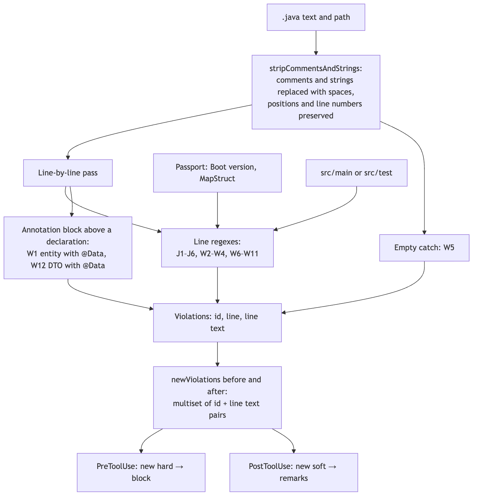

# 04. Rules

All rules are in `hooks/lib/rules.mjs` (J, W, G, S: text) and `hooks/lib/guard.mjs`
(G, S: checks). Each rule has three parts that go into the message to the model:
**what is wrong**, **how to fix it**, **an example**.

## Hard: they block

| Id | What it catches | Where it applies | Fix |
|---|---|---|---|
| J1 | `@Autowired` on a field | everything except `src/test/` | `private final` + `@RequiredArgsConstructor` |
| J2 | `import javax.persistence / validation / servlet`, `javax.annotation.PostConstruct` | Boot 3+ according to the passport | the same API in `jakarta.*` |
| J3 | `System.out`, `System.err`, `printStackTrace()` | `src/main/` | `@Slf4j`, `log.error("...", e)` |
| J4 | `@MockBean`, `@SpyBean` | Boot 4+ according to the passport | `@MockitoBean`, `@MockitoSpyBean` |
| J5 | `import org.junit.Test`, `@RunWith` | everywhere | JUnit 5: `org.junit.jupiter.api.Test`, `@ExtendWith` |
| J6 | a new `@Disabled` | `src/test/` | fix the code or the test; disable a test only with the user's consent |
| G1 | changes to existing lines of a Liquibase changelog from `main` | `db/changelog/` | a new changeset file |
| G2 | an edit of a committed gate config | `CodeRulesTest*`, `archunit_store/`, `archunit.properties`, `checkstyle*suppress*.xml`, `spotbugs*exclude*.xml` | fix the code the rule complains about; the user changes the rule |
| S1 | `git push --force`, `git reset --hard`, `git clean -f` | shell | a normal push, `git stash`, or let the user run it |
| S2 | `mvn verify/install/test/deploy` with `-DskipTests` and similar | shell | run it without skipping and fix what fails |

## Soft: remarks after a write

| Id | What it catches |
|---|---|
| W1 | `@Data`, `@EqualsAndHashCode`, `@ToString` on an `@Entity` (except `onlyExplicitlyIncluded = true`) |
| W2 | `@ManyToOne` / `@OneToOne` without `fetch = LAZY` |
| W3 | `@Enumerated` without `EnumType.STRING` |
| W4 | `@Transactional` on a `private` or `final` method |
| W5 | an empty `catch` without a comment |
| W6 | `@SneakyThrows` |
| W7 | string concatenation in a logger call |
| W8 | an `*Impl` class (except `*RepositoryImpl` — Spring Data requires fragments to be named this way) |
| W9 | a repository in a controller field or parameter |
| W10 | a MapStruct `@Mapper` without `unmappedTargetPolicy` and without `config =` |
| W11 | `Optional` as a field or parameter |
| W12 | a DTO class (`*Dto`, `*Request`, `*Response`) with `@Data` where a record would fit |

## How rules are detected in code



1. **Comments and strings become spaces.** `stripCommentsAndStrings` replaces the
   contents of comments, strings, text blocks and character literals with spaces,
   keeping the length and the line breaks. `"@Autowired"` in a string or
   `// System.out` in a comment is not a violation, and line numbers match the source.
2. **Line-based regexes.** Most rules are a regex over a line. J1 checks that the
   annotation is followed by a declaration that ends with `;` and has no parentheses:
   that is a field, not a constructor or a method. W2, W3 and W10 read the annotation
   arguments up to the closing parenthesis, even if they continue on the following
   lines.
3. **The annotation block above a declaration.** For W1 and W12 the hook collects the
   annotations above `class` / `record` and checks whether they include `@Entity` and
   `@Data`.
4. **File context.** The path (`src/main` / `src/test`) and the passport (Boot version,
   MapStruct) turn rules on and off: J2 only on Boot 3+, J4 only on Boot 4+.
5. **"Before" and "after".** The hook always compares the file's violations before and
   after the write. The comparison key is the rule + the trimmed line text, taking
   repeats into account. This gives the main property: **only what the edit introduced
   is blocked**. Legacy code does not get in the way.

Regexes do not see types. Anything that requires knowing the class of a field or who
calls whom lives in the ArchUnit gate `java-quality-gates`: it checks the bytecode during
the build.

## File roles

`roles.mjs` determines the role by annotations (`@RestControllerAdvice`,
`@RestController`, `@Entity`, MapStruct `@Mapper`, `@Repository` or
`extends JpaRepository`, `@Service`, `@Configuration`), then by name (`*Controller`,
`*Service`, `*Repository`, `*Mapper`, `*Config`, `*Properties`, `*Dto`, `*Request`,
`*Response`). Everything in `src/test/` is `test`, everything in `db/changelog/` is
`liquibase`.

| Role | What the rules cover |
|---|---|
| controller | one service call, records for input and output, `@Valid`, errors through an advice |
| service | a concrete class, `@Transactional` on public methods, self-invocation bypassing the proxy, DTOs as output |
| repository | `JpaRepository`, join fetch / `@EntityGraph` against N+1, `Optional` and `Page` |
| entity | `@Getter @Setter`, equals by id, LAZY, `EnumType.STRING`, migrations |
| dto | record, suffixes, validation on the components |
| mapper | MapStruct with `ReportingPolicy.ERROR` or a factory in the record |
| config | `@ConfigurationProperties` record, client timeouts, profiles |
| exception-handler | one advice, `ProblemDetail`, 500 without the exception text |
| test | JUnit 5 + AssertJ, slices, `@MockitoBean` / `@MockBean` depending on the version |
| liquibase | do not edit a changeset from `main`, one logical change, rollback |

Each set is ≤ 120 tokens (checked by `scripts/check-tokens.mjs`).

## Disabling a rule

A rule can be disabled **only by the user**, in the project's `forbxpg-java.json`:

```json
{ "disable": ["J3"] }
```

For example, J3 for a CLI utility that legitimately writes to `System.out`. The model is
not allowed to edit this file itself: every hard message tells it to stop and ask.

Next: [05. Passport, state, configuration](05-state-config-passport.md).
