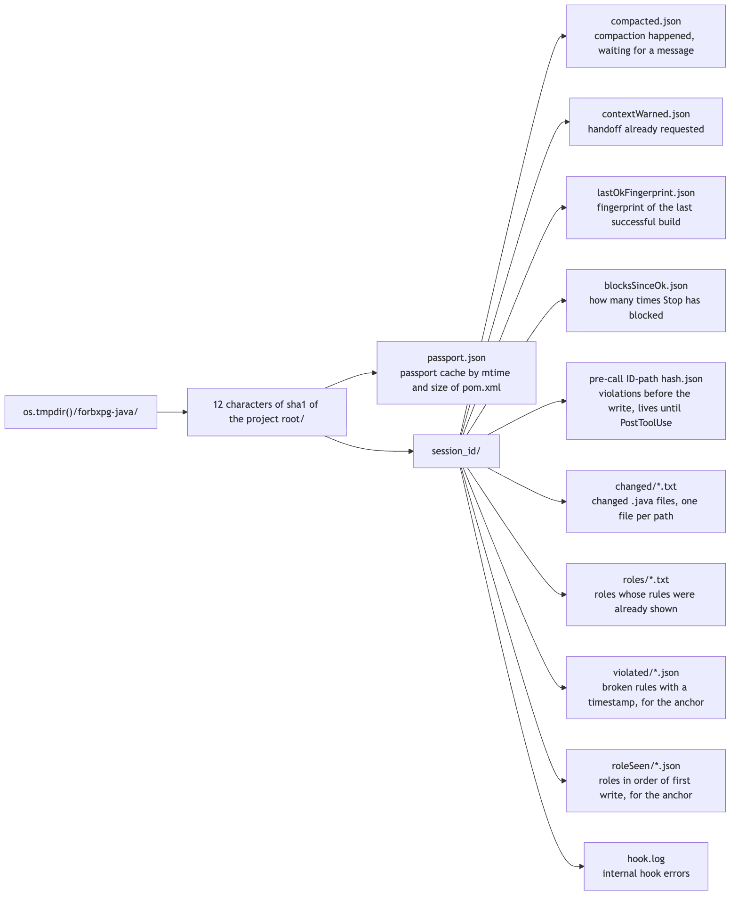

# 05. Passport, state, configuration

A hook is a short-lived process. To behave sensibly, it needs to know the project (the
passport), remember what happened in the session (the state), and respect the team's
preferences (the configuration). Hooks **never write inside the project**: everything
they keep lives in the OS temporary folder.

## Project passport

`hooks/lib/passport.mjs` reads the root `pom.xml` and all modules from `<modules>`
recursively. It uses only regexes and does not run Maven.

| Field | Source |
|---|---|
| `java` | `maven.compiler.release`, `java.version`, `maven.compiler.source/target`, `release` — the first one found, `1.8 → 8` |
| `boot` | `spring-boot-starter-parent` in `<parent>`; otherwise the `spring-boot.version` / `spring.boot.version` properties, the `spring-boot-dependencies` BOM in any pom, the `spring-boot-maven-plugin` version. Works behind a corporate parent and in an aggregator |
| `lombok`, `mapstruct`, `mapstructBinding` | dependencies |
| `liquibase`, `flyway`, `h2`, `testcontainers` | dependencies |
| `web` | `webmvc`, `webflux`, `feign` |
| `quality` | checkstyle, spotbugs, spotless, errorprone, archunit, jacoco, enforcer |
| `modules`, `wrapper` | `<modules>`, presence of `mvnw` / `mvnw.cmd` |
| `docker` | whether there is a Docker socket (`/var/run/docker.sock` or `\\.\pipe\docker_engine`) |
| `framework` | `quarkus`, `spring`, `jakarta` or `plain` |

The passport line: `Maven · Java 21 · Boot 4.0 · Lombok · MapStruct · Liquibase`. For
Quarkus and Jakarta EE it is `Quarkus: no specific rules`: Spring rules do not fit there,
and the router tells the model to follow the project's code and use only
`java-language`.

The passport is cached in `passport.json` by the modification time and size of the root
`pom.xml`. If you change `pom.xml`, the next hook call reads it again.

The passport affects the rules: J2 only on Boot 3+, J4 only on Boot 4+, the advice about
`@MockitoBean` or `@MockBean` depending on the Boot version, "Liquibase changeset" or
"Flyway migration" depending on the dependencies, `./mvnw` or `mvn` in the anchor.

## Session state

`hooks/lib/state.mjs`. Everything lives in `os.tmpdir()/forbxpg-java/`:



- The project folder is the first 12 characters of the sha1 of the root path. Different
  projects do not interfere with each other.
- The session folder is the `session_id` from the harness (characters outside
  `A-Za-z0-9_.-` are replaced with `_`). Without a `session_id` it is `unknown`. Two
  parallel sessions in the same project do not interfere with each other.
- Key-value data is a separate JSON file per key.
- **Sets** (changed files, shown roles) are one marker file per element, created with the
  "only if it does not exist" flag. Parallel hook calls (the harness may perform several
  writes at once) do not lose elements: there is no shared list for two processes to
  overwrite one after the other.
- **Ordered sets** for the anchor (`violated/` — broken rules, `roleSeen/` — roles in the
  order of their first write) are also one file per element, containing `{key, at}`. The
  `at` timestamp is always greater than the timestamps of the other elements, so the
  order is preserved even with several records within the same millisecond. Breaking a
  rule again updates its timestamp and moves it to the top.
- The `pre-*` snapshot is deleted in `PostToolUse` right after it is used.
- For the status line: `lastBuild` (`{result: ok|fail|unverified, at}`, written by Stop),
  `compactions` (compactions in the session, never reset) and the shared
  `update-check/status.json` (`{installed, latest, at}`, written at session start).

The OS temporary folder is cleaned up by the system; the hooks do not need old sessions.

## Configuration

`hooks/lib/config.mjs`. Two optional files; the project wins for each key:

1. `forbxpg-java.json` in the root of the Maven project;
2. `~/.forbxpg-java.json` for all of the user's projects;
3. default values.

```json
{
  "anchor": null,
  "stopCompile": true,
  "contextWarnAt": 0.7,
  "disable": []
}
```

| Key | Default | Meaning |
|---|---|---|
| `anchor` | `null` — enabled in GigaCode, disabled in Claude Code and Codex | the adaptive anchor on every message |
| `stopCompile` | `true` | compile at the end of a turn |
| `contextWarnAt` | `0.7` | at what context usage to ask for a handoff (GigaCode only) |
| `disable` | `[]` | ids of disabled rules |

Malformed JSON in a configuration file is treated as if the file did not exist: the hook
does not crash.

Next: [06. Skills and the router](06-skills.md).
