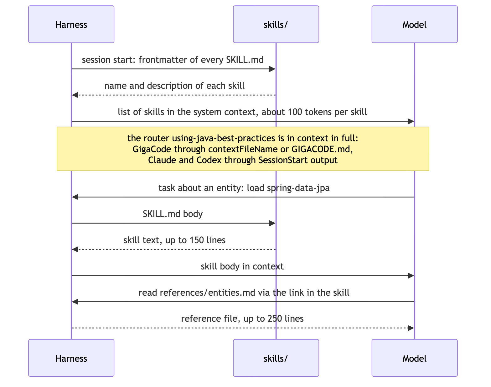

# 06. Skills and the router

## What a skill is

A skill is a `skills/<name>/` folder that follows the [Agent Skills](https://agentskills.io)
specification:

```text
skills/spring-data-jpa/
├── SKILL.md                  # frontmatter + main text (≤ 150 lines)
└── references/               # reference files (≤ 250 lines each), read via links
    ├── entities.md
    ├── liquibase.md
    └── queries-and-n-plus-1.md
```

`SKILL.md` starts with frontmatter:

```yaml
---
name: spring-data-jpa
description: JPA / Hibernate entities, Spring Data repositories, queries and schema changes with Liquibase. Use when creating or changing an @Entity or repository, ...
---
```

`name` is the identifier. `description` is the **only** thing the model sees about a skill
before it is loaded. The model uses it to decide whether to load the skill. That is why the
description says "when to use it" rather than "what is inside": it lists the tasks and the
words the user will come with.

## How the harness loads skills



There are three levels, from cheap to expensive:

1. **Catalog**: the name and description of every skill, always in context. About 100
   tokens per skill.
2. **The `SKILL.md` body**: loaded when the model decides the skill is needed (Claude Code
   uses the Skill tool, GigaCode and Codex have their own activation mechanisms).
3. **The `references/` files**: the model reads a file only when the skill body links to
   it and the task requires it.

This way the context holds only what the current task needs.

Where the harness looks for skills:

| Harness | Plugin / extension | Project | User |
|---|---|---|---|
| Claude Code | the plugin's `skills/` | `.claude/skills/` | `~/.claude/skills/` |
| GigaCode | the extension's `skills/` | `.gigacode/skills/` | `~/.gigacode/skills/` |
| Codex | `skills` in `.codex-plugin/plugin.json` | — | `~/.agents/skills/` |

## The router

`using-java-best-practices` is a special skill. It does not need to be "chosen": it is
**always in context in full**:

- GigaCode: through `contextFileName` in `gigacode-extension.json`, or through the line
  `@.gigacode/skills/using-java-best-practices/SKILL.md` in `GIGACODE.md` for a project
  install;
- Claude Code and Codex: the `SessionStart` hook prints its text after the passport.

Inside:

1. **13 rules that always apply**: which skill to load first, packages by layer, services
   without `*Impl`, constructor injection, DTO records, entities without `@Data`,
   MapStruct, ProblemDetail, Liquibase, logging, tests, small steps, and "done" only with
   build output.
2. **A "which skill when" table**: routing by stage of work.
3. **What the hooks do**: so that the model understands a refusal and does not try to work
   around it.
4. **Working with the user**: follow the project's code, do not rewrite legacy code unless
   asked, do not work around a hook.

The router's budget is 1500 tokens (`scripts/check-tokens.mjs`): it is paid for in every
session.

## Ten skills

| Skill | When it is loaded |
|---|---|
| `using-java-best-practices` | always (the router) |
| `java-design-decisions` | planning, grilling, a spec, a change plan before code |
| `java-conventions` | a new class, package, module or project; naming, Lombok, DTOs and mapping, configuration |
| `java-language` | plain Java 21 / 25: records, sealed types, patterns, Optional, exceptions, collections, concurrency |
| `spring-boot-service` | controllers, validation, errors, services and transactions, proxies, HTTP clients, `@Async`, `@Scheduled` |
| `spring-data-jpa` | entities, repositories, queries, N+1, locking, Liquibase |
| `java-testing` | writing or fixing tests, coverage, flaky tests |
| `java-code-review` | review of code, a diff, a PR |
| `java-verification` | before any "it compiles", "tests passed", "done" |
| `java-quality-gates` | adding ArchUnit, Enforcer, JaCoCo to a project |

## How skills and hooks complement each other

- A skill says **how to write** and **why**. A hook checks the **result**.
- The text of a hook message (what is wrong, how to fix it, an example) matches the skill.
  A model that gets a refusal also gets a ready solution: it does not need to look for it
  in the skill.
- The file role in `PostToolUse` is a digest of the relevant skill section, delivered
  exactly when the model writes a file with that role.
- The recovery block after compaction repeats the router's main rules: compaction may have
  dropped the router from the context.

## Skill checks

`scripts/validate-skills.mjs` (in CI):

- frontmatter follows the Agent Skills specification, only allowed keys;
- the name fits both the specification (`a-z0-9-`) and GigaCode;
- `SKILL.md` ≤ 150 lines, reference files ≤ 250;
- every link to `references/` exists;
- every skill has ≥ 2 cases in `evals/routing.tsv`.

`scripts/eval-routing.mjs` checks routing: the model is given only the names and
descriptions and is asked which skill to load for a request from `evals/routing.tsv`. It
needs an OpenAI-compatible endpoint and does not run in CI.

Next: [07. Installation from the inside](07-installation.md).
