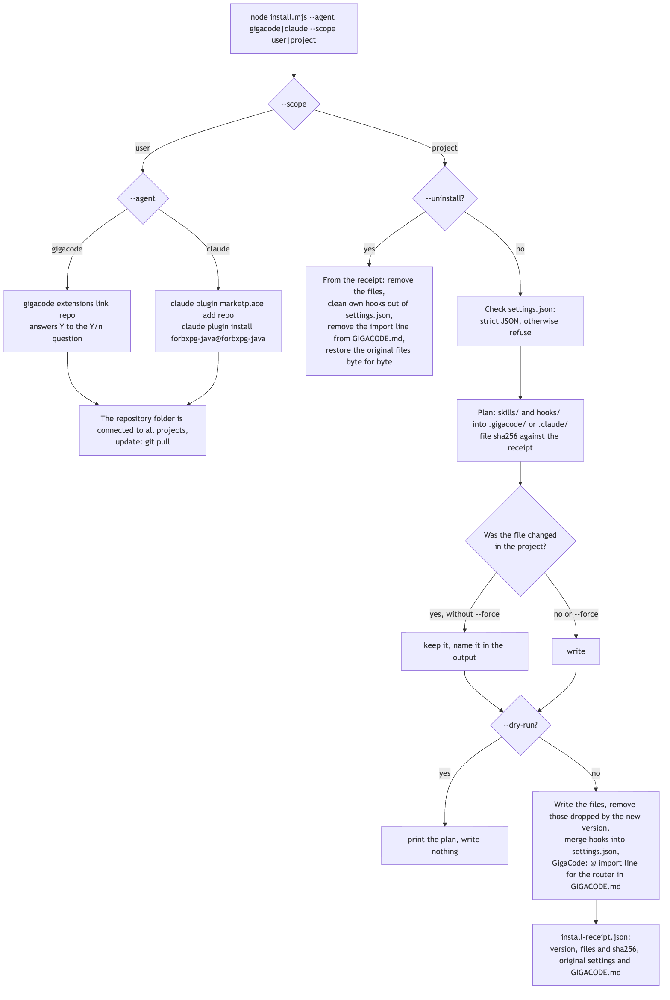

# 07. Installation from the inside

`install.mjs` is a thin wrapper: it parses the arguments and calls `installer/user.mjs` or
`installer/project.mjs`.

## User scope: for yourself, in all projects

The installer copies nothing itself. It calls the agent's CLI, which registers the
**repository folder** as a plugin or an extension:

| Agent | Install | Remove |
|---|---|---|
| GigaCode | `gigacode extensions link <repo>` with the answer `Y` | `gigacode extensions uninstall forbxpg-java` |
| Claude Code | `claude plugin marketplace add <repo>`, `claude plugin install forbxpg-java@forbxpg-java` | `claude plugin uninstall ...`, `claude plugin marketplace remove forbxpg-java` |

- For GigaCode it is `link`, not `install`: `install` sees `.claude-plugin/` and installs
  the folder as a Claude plugin, losing the context file and the hooks.
- `link` asks "Do you want to continue? [Y/n]", and without an answer in a non-interactive
  shell it silently installs nothing. The installer passes `Y` on stdin.
- Update: `git pull` in the repository folder. The harness reads the files directly from
  it.
- On Windows, `gigacode.cmd` and `claude.cmd` are run through the shell.

## Project scope: in the repository, for the whole team

Skills and hooks are **copied into the repository** and committed. Every developer gets
them through git without installing anything.

| | GigaCode | Claude Code |
|---|---|---|
| Skills | `.gigacode/skills/` | `.claude/skills/` |
| Hook code | `.gigacode/forbxpg-java/hooks/` | `.claude/forbxpg-java/hooks/` |
| Registration | `.gigacode/settings.json` | `.claude/settings.json` |
| Command | `node .gigacode/forbxpg-java/hooks/java-hooks.mjs <Event> --harness gigacode` | `node "$CLAUDE_PROJECT_DIR/.claude/forbxpg-java/hooks/java-hooks.mjs" <Event> --harness claude` |
| Router | an `@` import line in `GIGACODE.md` | printed by the `SessionStart` hook |
| Receipt | `.gigacode/forbxpg-java/install-receipt.json` | `.claude/forbxpg-java/install-receipt.json` |

### Install

1. **Check before the first write.** `settings.json` must be strict JSON. If it has
   comments or trailing commas, the install refuses and touches nothing: such a file cannot
   be rewritten without losing the comments.
2. **Plan.** Every file from `skills/` and `hooks/` is compared by sha256 with the receipt
   of the previous install. A file that the team changed in the project is **not
   overwritten** without `--force` and is named in the output.
3. `--dry-run`: print the plan and exit.
4. **Write.** Copies the files. Removes files that are not in the new version, unless they
   were changed.
5. **Merge `settings.json`.** The installer recognises its own entries by `forbxpg-java` in
   the command. Its old entries are removed, and the new ones are added **after** everyone
   else's. Other keys and other tools' hooks are not touched.
6. **GigaCode: `GIGACODE.md`.** Adds the router import line if it is not there yet.
7. **Receipt:** the version, the files with their sha256, whether `.gigacode/` / `.claude/`
   was created, and the original text of `settings.json` and `GIGACODE.md` before the first
   install.

A repeated install and `--update` are the same operation: the install is idempotent.

### Uninstall (`--uninstall`)

It works from the receipt, and only on what the receipt lists:

1. Removes the files listed in the receipt and any folders left empty.
2. Cleans its own hooks out of `settings.json`. If the file did not exist before the install
   and no one else's settings are left in it, the file is removed. If it existed and is
   unchanged in meaning, its **original text is restored byte for byte**. The `"$version"`
   key, which GigaCode adds to `settings.json` on its own, does not count as a team setting
   here.
3. Removes the import line from `GIGACODE.md` and restores the original file, or removes it
   if the install created it.
4. Removes the receipt and `.gigacode/` / `.claude/` if the install created them.

The result is covered by a test: install followed by uninstall leaves the project exactly as
it was.

### What matters for the team

- Commit the result of the install.
- GigaCode runs the project hook with a path from the project root and does not read the
  parent folder's `.gigacode/settings.json` if the session is opened in a subfolder. Open
  sessions in the repository root.
- Two installs (GigaCode and Claude Code) live in the same repository independently:
  removing one does not touch the other.

Next: [08. Harness differences](08-harnesses.md).
