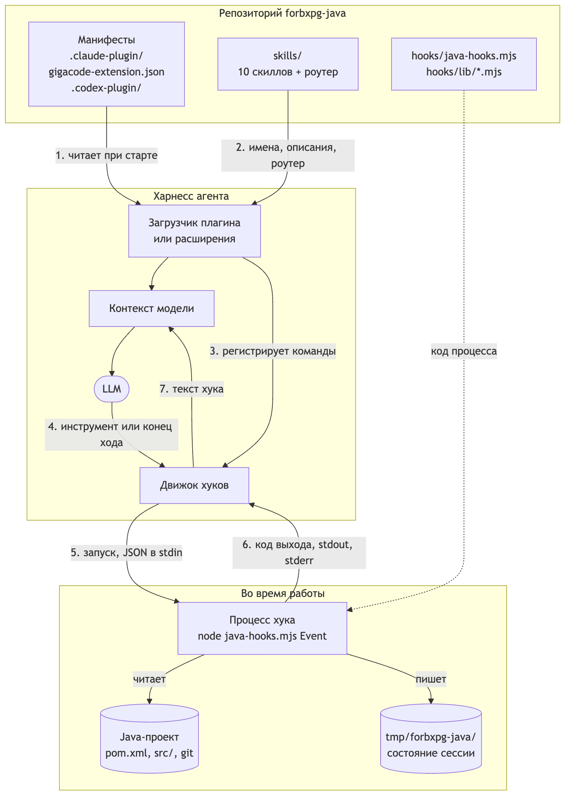
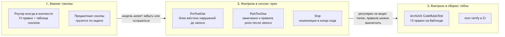

# 01. Обзор

forbxpg-java — набор правил Java / Spring Boot для агентов, который работает в трёх
харнессах: Claude Code, GigaCode и Codex. Он состоит из двух половин:

- **скиллы** — тексты, которые модель читает и по которым пишет код;
- **хуки** — маленькая программа на Node, которую харнесс запускает в ключевые моменты
  работы агента и которая проверяет, что модель сделала.

Скиллы объясняют, как надо. Хуки следят, чтобы так и было.

## Словарь

| Термин | Что значит здесь |
|---|---|
| **Харнесс** | Программа-агент вокруг модели: Claude Code, GigaCode, Codex. Она показывает модели инструменты (запись файла, shell), выполняет их и запускает хуки |
| **Модель** | LLM внутри харнесса. Видит только текст своего контекста |
| **Хук** | Команда, которую харнесс запускает при событии (старт сессии, запись файла, конец хода). У нас это всегда `node java-hooks.mjs <Event> --harness <имя>` |
| **Событие** | Момент жизненного цикла: `SessionStart`, `UserPromptSubmit`, `PreToolUse`, `PostToolUse`, `PostCompact`, `Stop` |
| **Скилл** | Папка `skills/<имя>/` с `SKILL.md`: frontmatter (имя и описание) + текст. Модель грузит его, когда задача подходит под описание |
| **Роутер** | Скилл `using-java-best-practices`: 13 правил и таблица «какой скилл когда». Всегда в контексте |
| **Паспорт** | Строка о стеке проекта, которую хук читает из `pom.xml`: `Maven · Java 21 · Boot 4.0 · Lombok` |
| **Жёсткое правило** | J1–J6, G1–G2, S1–S2. Нарушение блокирует запись или команду |
| **Мягкое правило** | W1–W12. Нарушение приходит модели замечанием после записи |
| **Роль файла** | controller, service, entity и т. д. При первой записи файла роли модель получает её короткие правила |

## Из чего состоит репозиторий

| Путь | Что это |
|---|---|
| `skills/` | 10 скиллов. `using-java-best-practices` — роутер |
| `hooks/java-hooks.mjs` | Единая точка входа всех хуков |
| `hooks/lib/*.mjs` | Логика: события (`pre`, `post`, `session`, `stop`), правила (`rules`, `roles`, `guard`), проект (`passport`, `io`, `config`), состояние (`state`), Maven (`maven`) |
| `hooks/hooks.json` | Регистрация хуков для плагина Claude Code |
| `hooks/hooks-codex.json` | Регистрация хуков для плагина Codex |
| `gigacode-extension.json` | Манифест расширения GigaCode: роутер, скиллы и хуки |
| `.claude-plugin/` | Манифест плагина и маркетплейса Claude Code |
| `.codex-plugin/plugin.json` | Манифест плагина Codex |
| `install.mjs`, `installer/` | Установщик: user-scope через CLI агента, project-scope копией в репозиторий |
| `skills/java-quality-gates/assets/CodeRulesTest.java` | ArchUnit-тест с 13 правилами, агент ставит его в проект по запросу |
| `scripts/` | Проверки скиллов, бюджет токенов, оценка роутинга, рендер диаграмм |
| `tests/` | `node --test`: 150+ тестов хуков и установщика, фикстуры, Maven-проект для гейтов |

Зависимостей нет: только Node ≥ 20 и его стандартная библиотека. Это сделано намеренно,
чтобы хуки работали на закрытой машине без `npm install` и одинаково на Windows (`cmd`),
Linux и macOS.

## Три слоя защиты

1. **Знание (скиллы).** Модель знает правила, потому что роутер всегда в контексте, а
   предметный скилл грузится под задачу. Этого не хватает: в длинной сессии модель
   забывает, после сжатия контекста теряет детали, слабая модель просто ошибается.
2. **Контроль в сессии (хуки).** Харнесс сам запускает проверку при каждой записи и в
   конце хода. Модель не может «забыть» вызвать хук: его вызывает не она. Но хук видит
   только текст, без типов, и правило можно выключить в `forbxpg-java.json`.
3. **Контроль в сборке (гейты).** ArchUnit-тест в проекте проверяет байткод при
   `mvn test` / `verify` и валит CI. Его не обойти выключением хука, и он видит типы и
   связи классов. Ставится скиллом `java-quality-gates`.

Каждый следующий слой ловит то, что пропустил предыдущий.

## Что хуки делают за одну сессию

Коротко, подробности — в [02](02-hooks-explained.md) и [03](03-hook-events.md):

| Когда | Что видит модель |
|---|---|
| Старт сессии | Паспорт проекта; в Claude Code и Codex ещё и текст роутера |
| Каждое сообщение (GigaCode) | Якорь: паспорт + три правила (сначала те, что модель нарушала), ≤ 60 токенов |
| Перед записью файла | Отказ, если запись вносит **новое** жёсткое нарушение |
| После записи | Новые мягкие замечания и, впервые за сессию, правила роли файла |
| После сжатия контекста | Один раз блок восстановления ≤ 500 токенов, с правилами, которые модель нарушала |
| Конец хода | Если сессия меняла `.java` — компиляция; на своих ошибках модель не может закончить |

Вне Maven-проекта хуки ничего не делают: выходят с кодом 0 без вывода.
