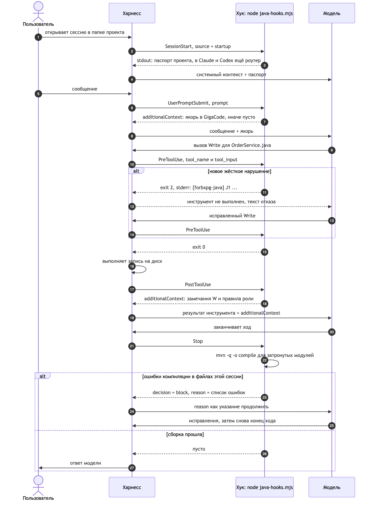
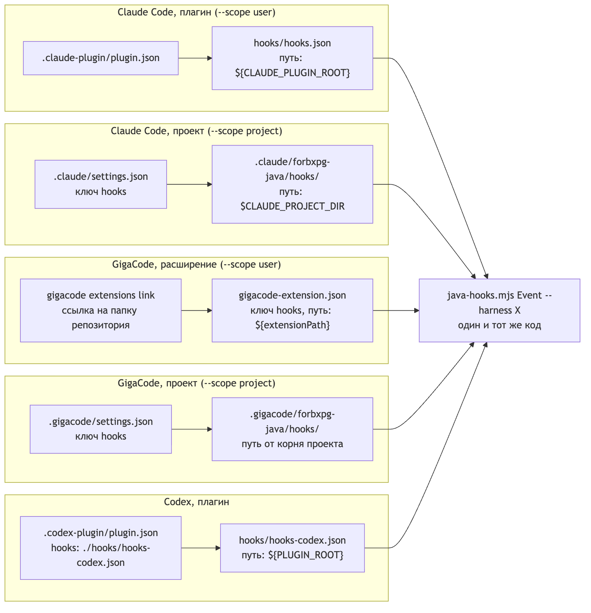
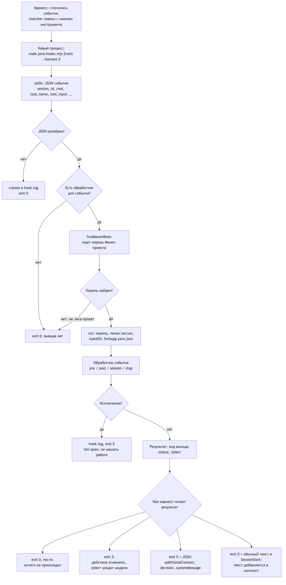
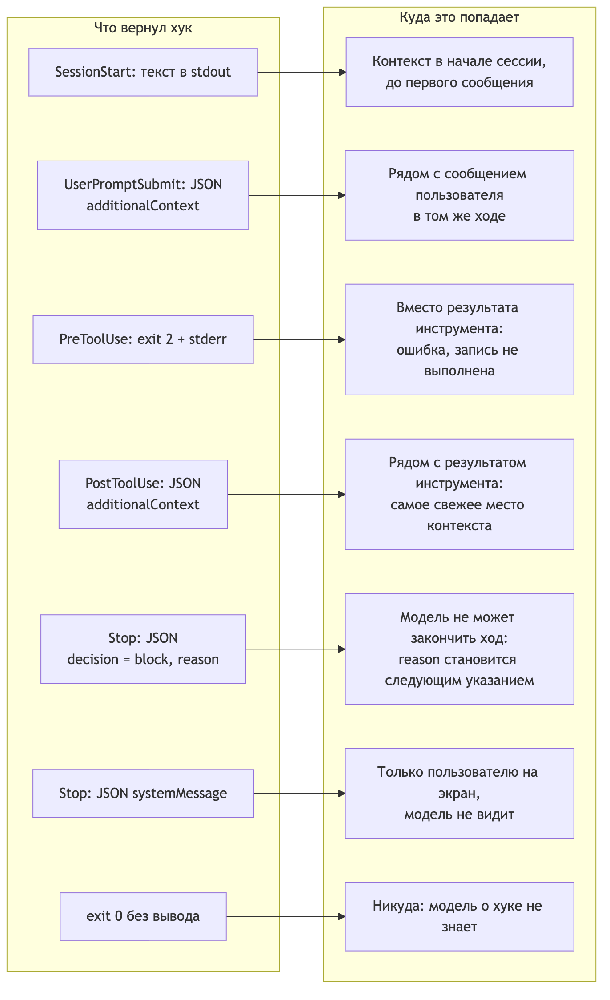
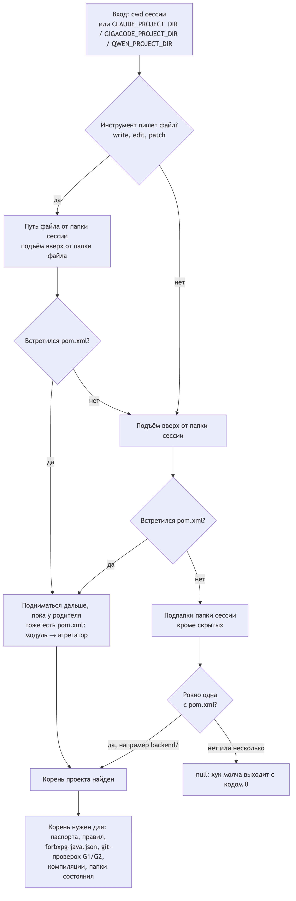

# 02. Хуки: что это и как работают

## Что такое хук

Хук — это **команда операционной системы**, которую харнесс сам запускает в определённый
момент работы агента. Не функция внутри модели и не инструмент, который модель может
вызвать или не вызвать. Модель про хуки вообще ничего не знает, пока хук не вернёт текст.

У каждого харнесса есть список **событий** жизненного цикла. Когда событие происходит,
харнесс смотрит в свои настройки, находит команды, подписанные на это событие, запускает
каждую отдельным процессом и ждёт результата. По результату он решает, продолжать ли
действие и что добавить в контекст модели.

forbxpg-java подписывает на все события одну и ту же команду:

```text
node <папка с хуками>/java-hooks.mjs <Event> --harness <claude|gigacode|codex>
```

`<Event>` — имя события, `--harness` говорит коду, в каком формате отвечать и какие
особенности учитывать.

## Почему хуки, а не только текст правил

| | Правило в скилле | Правило в хуке |
|---|---|---|
| Кто запускает | Модель решает сама, прочитать ли | Харнесс, всегда, при каждом событии |
| Длинная сессия | Тонет в контексте | Проверяет каждую запись одинаково |
| После сжатия контекста | Может пропасть | Код хука не в контексте и не сжимается |
| Слабая модель | Читает и всё равно нарушает | Нарушение не попадает на диск |
| Цена в токенах | Весь текст правила всегда | Ноль, пока нарушения нет |
| Что видит | Всё, что модель поняла | Только текст файла и команды, без типов |

Хук детерминирован: одна и та же правка всегда даёт один и тот же ответ. Поэтому
жёсткие правила (то, что ломает сборку, данные или историю git) живут в хуках, а
скиллы объясняют, зачем это правило и как писать правильно с первого раза.

## Жизненный цикл одной сессии



Что здесь важно:

- **Хук — отдельный процесс на каждое событие.** Между вызовами в памяти ничего не
  остаётся. Всё, что надо помнить (было ли сжатие, какие файлы менялись), хук пишет во
  временную папку ОС ([05](05-state-config-passport.md)).
- **Харнесс ждёт хук.** Пока `PreToolUse` не ответил, файл не записан. Пока `Stop` не
  ответил, ход не закончен. Поэтому у хуков таймауты: 10 с на всё, кроме `Stop`
  (200 с, потому что он компилирует).
- **Модель не видит, что хук был вызван,** если хук ничего не вернул. Она видит только
  текст, который хук отдал, в том месте, куда харнесс его положил.

## Где хранятся хуки

Хук записан в двух местах: **регистрация** (какое событие → какая команда) и **код**
(`java-hooks.mjs` + `lib/`). Где лежит то и другое, зависит от харнесса и способа
установки.



| Установка | Регистрация | Код | Как команда находит код |
|---|---|---|---|
| Claude Code, плагин | `hooks/hooks.json` в папке плагина | `hooks/` в папке плагина | `${CLAUDE_PLUGIN_ROOT}` — харнесс подставляет путь к плагину |
| Claude Code, проект | ключ `hooks` в `.claude/settings.json` | `.claude/forbxpg-java/hooks/` | `$CLAUDE_PROJECT_DIR` — путь к корню проекта |
| GigaCode, расширение | ключ `hooks` в `gigacode-extension.json` | `hooks/` в папке репозитория (её подключает `extensions link`) | `${extensionPath}` и `${/}` — путь к расширению и разделитель пути ОС |
| GigaCode, проект | ключ `hooks` в `.gigacode/settings.json` | `.gigacode/forbxpg-java/hooks/` | относительный путь от корня проекта: GigaCode запускает хук из корня |
| Codex, плагин | `hooks/hooks-codex.json` (на него ссылается `.codex-plugin/plugin.json`) | `hooks/` в папке плагина | `${PLUGIN_ROOT}` |

Одна запись регистрации выглядит так (Claude Code, `hooks/hooks.json`):

```json
"PreToolUse": [
  {
    "matcher": "Write|Edit|MultiEdit|Bash",
    "hooks": [
      {
        "type": "command",
        "command": "node \"${CLAUDE_PLUGIN_ROOT}/hooks/java-hooks.mjs\" PreToolUse --harness claude",
        "timeout": 10
      }
    ]
  }
]
```

- `matcher` — регулярка по имени инструмента. Хук на запись не запускается, когда модель
  читает файл или ищет по коду: лишний процесс Node не нужен.
- `timeout` — в секундах у Claude Code и Codex, в миллисекундах у GigaCode (`10000`).
- Несколько хуков на одно событие (например, ваш собственный и наш) работают независимо.
  При установке в проект установщик **добавляет** свои записи к чужим, а не заменяет их
  ([07](07-installation.md)).

Харнессы читают регистрацию **при старте сессии**. После установки или обновления хуков
откройте новую сессию.

### Одобрение хуков

Хук — это произвольная команда на вашей машине, поэтому харнессы осторожны:

- **Claude Code**: хуки плагина работают после установки плагина. Хуки из
  `.claude/settings.json` проекта работают в доверенной папке; правку хуков посреди
  сессии Claude Code показывает в `/hooks` на проверку.
- **GigaCode**: хуки включены по умолчанию, выключатель — `"disableAllHooks": true` в
  `~/.gigacode/settings.json`. В неинтерактивном режиме (`gigacode -p`) хуки проекта
  работают без вопроса.
- **Codex**: хуки плагина запускаются только после явного доверия в `/hooks`.

## Как хук общается с харнессом

Протокол одинаковый у всех трёх харнессов (GigaCode и Codex повторяют формат Claude Code):

- **вход** — JSON события в **stdin**;
- **выход** — **код выхода**, **stdout** и **stderr**.



### Вход: что приходит в stdin

Пример `PreToolUse` от Claude Code, когда модель пишет файл:

```json
{
  "session_id": "s-claude",
  "cwd": "/proj",
  "hook_event_name": "PreToolUse",
  "tool_name": "Write",
  "tool_input": { "file_path": "/proj/src/main/java/a/Foo.java", "content": "class Foo {}\n" },
  "tool_use_id": "toolu_c1"
}
```

То же от GigaCode для правки:

```json
{
  "session_id": "s-giga",
  "cwd": "C:\\proj",
  "hook_event_name": "PreToolUse",
  "tool_name": "edit",
  "tool_input": { "file_path": "C:\\proj\\src\\main\\java\\a\\Foo.java", "old_string": "class Foo {}", "new_string": "class Foo { int x; }" },
  "tool_use_id": "toolu_g2"
}
```

Codex правит файлы через `apply_patch`, и в `tool_input` приходит текст патча:

```json
{ "tool_name": "apply_patch", "tool_input": { "input": "*** Begin Patch\n*** Update File: src/main/java/a/Foo.java\n*** End Patch" } }
```

Имена инструментов и полей у харнессов разные. `normalizeTool` (`hooks/lib/io.mjs`)
сводит их к пяти видам: `write`, `edit`, `shell`, `patch`, `other`. Дальше код не
знает, какой харнесс его вызвал.

Другие события приносят свои поля: `source` у `SessionStart` (`startup`, `resume`,
`clear`, `compact`), `prompt` у `UserPromptSubmit`, `stop_hook_active` и (только
GigaCode) `context_usage` у `Stop`.

### Выход: что хук может ответить

| Ответ | Смысл для харнесса | Где у нас |
|---|---|---|
| exit 0, пусто | Всё в порядке, ничего не добавлять | Большинство вызовов |
| exit 2 + текст в stderr | **Отменить действие**, stderr отдать модели | `PreToolUse`: жёсткое нарушение |
| exit 0 + JSON `hookSpecificOutput.additionalContext` | Добавить текст в контекст модели | `UserPromptSubmit`, `PostToolUse` |
| exit 0 + JSON `{"decision": "block", "reason": ...}` | Не дать модели закончить ход, `reason` — что делать | `Stop`: свои ошибки компиляции, handoff |
| exit 0 + JSON `{"systemMessage": ...}` | Показать **пользователю**, модели не отдавать | `Stop`: сборку проверить не удалось |
| exit 0 + обычный текст | Для `SessionStart`: добавить в контекст | Паспорт и роутер |
| любой другой код | Ошибка хука, действие продолжается | У нас не бывает: внутренние ошибки → exit 0 |

**Fail open.** Если внутри хука что-то сломалось (битый JSON, исключение), он пишет
строку в `hook.log` и выходит с кодом 0. Сломанный хук никогда не мешает работать:
хуже пропустить нарушение, чем заблокировать всю работу из-за ошибки в проверке.

## В какой момент агент «понимает» хук

Модель узнаёт о хуке **только по тексту, который харнесс положил в её контекст**.
Где именно окажется текст, зависит от события и вида ответа:



На живом прогоне в Claude Code это выглядит так.

**Отказ до записи.** Модель вызвала `Write` с полем `@Autowired`. Вместо результата
инструмента она получила:

```text
PreToolUse:Write hook error: [node ".../java-hooks.mjs" PreToolUse --harness claude]:
[forbxpg-java] J1: @Autowired on a field in production code (line 10). Fix: make the field
private final and inject it through the constructor with Lombok @RequiredArgsConstructor.
Example: @RequiredArgsConstructor class OrderService { private final OrderRepository orders; }.
If the user explicitly asked for this, stop and ask the user ... do not retry or work around it
```

Файл не записан. Модель читает, что не так, как исправить и пример, и пишет заново.
В GigaCode тот же отказ приходит как `Tool "edit" was not run: [forbxpg-java] J1: ...`.

**Замечание после записи.** Запись прошла, и рядом с результатом инструмента модель
видит `additionalContext`:

```text
[forbxpg-java] W1: @Data / @EqualsAndHashCode / @ToString on an @Entity: ... (line 11).
Fix: use @Getter @Setter @NoArgsConstructor(access = AccessLevel.PROTECTED) ...
[forbxpg-java] entity rules:
- @Getter @Setter @NoArgsConstructor(access = PROTECTED); never @Data, @EqualsAndHashCode, @ToString.
- equals/hashCode on the id; @ManyToOne/@OneToOne(fetch = LAZY); @Enumerated(EnumType.STRING).
- Schema changes go in a new Liquibase changeset, never ddl-auto.
```

Это самое свежее место контекста: модель видит замечание сразу после своей правки и
обычно исправляет его следующим шагом.

**Блок в конце хода.** Модель хочет закончить, но `Stop` вернул `decision: block`.
Харнесс не отдаёт ответ пользователю, а передаёт модели `reason`:

```text
[forbxpg-java] The code does not compile:
- src/main/java/com/example/service/OrderService.java:14 cannot find symbol
Fix these errors before you finish.
```

Модель продолжает работу, исправляет и снова пытается закончить ход.

### Почему отказ — именно exit 2

В Claude Code `PreToolUse` может вернуть мягкую подсказку через `additionalContext` или
`permissionDecision`. Но в GigaCode `additionalContext` из `PreToolUse` до модели **не
доходит**, а отказ с кодом 2 и текстом в stderr доходит (проба на GigaCode 26.11.141).
Чтобы поведение было одинаковым везде, все жёсткие правила отвечают кодом 2.

### Почему каждое жёсткое сообщение заканчивается «stop and ask»

Модель, которой хук отказал, может попытаться обойти его: записать файл через shell,
разбить правку на части. Поэтому каждое жёсткое сообщение заканчивается фразой: если
пользователь сам явно просил это, остановись и спроси его, не повторяй и не обходи. В
живом прогоне модель так и сделала: на промпт «добавь поле с `@Autowired`» она не стала
обходить J1, а предложила пользователю выбор — внедрение через конструктор или
выключить правило в `forbxpg-java.json`.

## Что хук делает при каждом вызове

Общая часть одна для всех событий (`hooks/java-hooks.mjs`):

1. Прочитать stdin и разобрать JSON. Не вышло — строка в `hook.log`, exit 0.
2. Найти обработчик для события. Неизвестное событие — exit 0.
3. Найти **корень Maven-проекта** (`findMavenRoot`, ниже). Не нашёлся — exit 0: это не
   Java-проект, хуку тут делать нечего.
4. Собрать контекст: корень, папку сессии (для относительных путей), папку состояния,
   настройки `forbxpg-java.json`.
5. Вызвать обработчик события и вернуть его ответ. Исключение — `hook.log`, exit 0.

### Как хук находит проект

Харнесс сообщает папку сессии (`cwd` во входе или переменные `CLAUDE_PROJECT_DIR`,
`GIGACODE_PROJECT_DIR`, `QWEN_PROJECT_DIR`). Но сессию могут открыть не в корне
Maven-проекта: в `src/`, в модуле или в корне git-репозитория, где Maven-проект лежит в
`backend/`. Поэтому корень ищется:



- Сначала вверх от **записываемого файла**: правило относится к проекту, которому
  принадлежит файл.
- Потом вверх от **папки сессии**.
- Подъём не останавливается на первом `pom.xml`: из модуля `core/` он дойдёт до
  агрегатора, если у родителя тоже есть `pom.xml`.
- Если вверх ничего, хук смотрит подпапки: ровно одна с `pom.xml` — это она.
- Две и больше Maven-подпапок и нет файла (старт сессии, конец хода, shell) — хук
  молчит, а не угадывает.

Относительные пути файлов из `tool_input` хук считает **от папки сессии**, а не от
найденного корня: так их понимает и сам харнесс.

## Код хуков: карта модулей

| Модуль | За что отвечает |
|---|---|
| `java-hooks.mjs` | Точка входа: stdin, поиск корня, выбор обработчика, fail open |
| `lib/io.mjs` | Папка сессии, поиск корня Maven, `normalizeTool` для трёх харнессов |
| `lib/session.mjs` | `SessionStart`, `PostCompact`, `UserPromptSubmit` |
| `lib/pre.mjs` | `PreToolUse`: построить файл после записи, найти новые жёсткие нарушения |
| `lib/post.mjs` | `PostToolUse`: новые замечания, правила роли, отметка изменённых файлов |
| `lib/stop.mjs` | `Stop`: предупреждение о контексте, компиляция, разбор ошибок |
| `lib/rules.mjs` | Каталог правил J / W, поиск нарушений, сравнение «до / после», текст сообщения |
| `lib/guard.mjs` | Правила не про Java: S1, S2 (shell) и G1, G2 (защищённые файлы, через git) |
| `lib/roles.mjs` | Роль файла и её короткие правила |
| `lib/passport.mjs` | Паспорт проекта из `pom.xml`, кэш |
| `lib/anchor-text.mjs` | Тексты якоря и блока восстановления |
| `lib/edit.mjs` | Применить `old_string → new_string`, как это сделает инструмент |
| `lib/javatext.mjs` | Заменить комментарии и строки пробелами, сохранив позиции |
| `lib/maven.mjs` | Команда компиляции, запуск с таймаутом, разбор ошибок `javac` |
| `lib/state.mjs` | Состояние сессии во временной папке, `hook.log` |
| `lib/config.mjs` | `forbxpg-java.json` проекта и `~/.forbxpg-java.json` |

Дальше: [03. События по порядку](03-hook-events.md).
