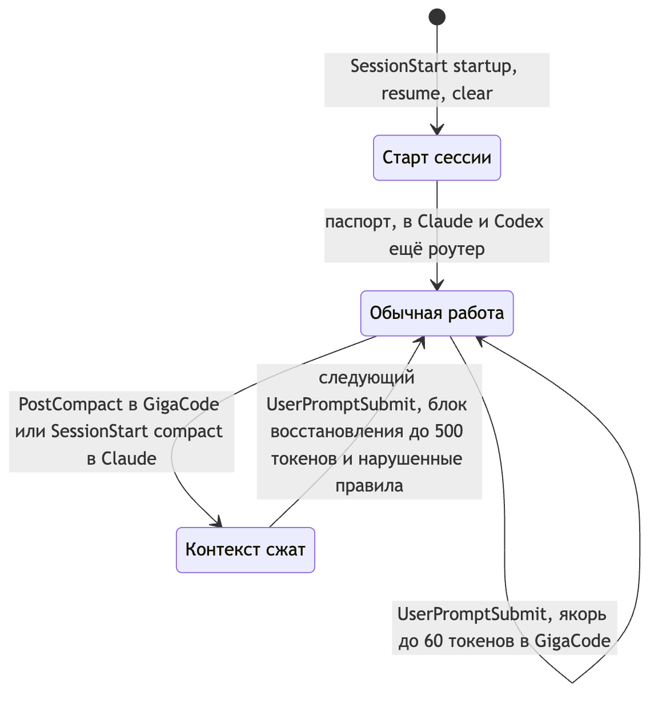
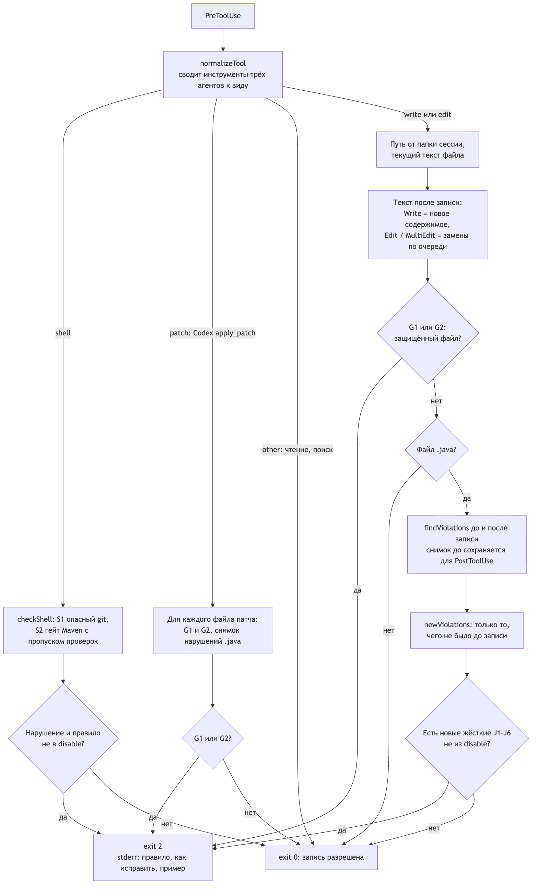
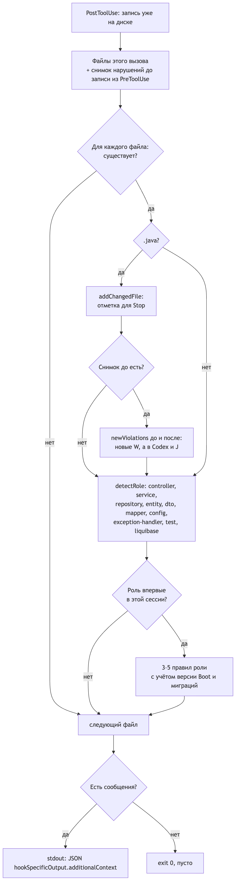
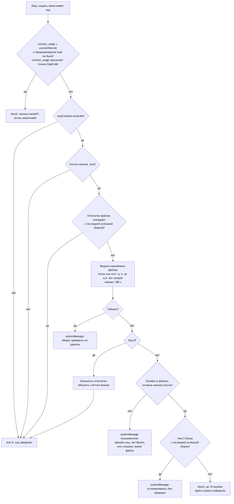

# 03. События по порядку

Какие события на что подписаны:

| Событие | Claude Code | GigaCode | Codex | Таймаут | Обработчик |
|---|---|---|---|---|---|
| `SessionStart` | да (`startup\|resume\|clear\|compact`) | да | да | 10 с | `session.mjs` |
| `UserPromptSubmit` | да | да | да | 10 с | `session.mjs` |
| `PreToolUse` | `Write\|Edit\|MultiEdit\|Bash` | `write_file\|edit\|replace\|run_shell_command` | `apply_patch\|Edit\|Write\|Bash\|exec_command` | 10 с | `pre.mjs` |
| `PostToolUse` | `Write\|Edit\|MultiEdit` | `write_file\|edit\|replace` | `apply_patch\|Edit\|Write` | 10 с | `post.mjs` |
| `PostCompact` | — (сжатие видно по `SessionStart compact`) | да | — | 10 с | `session.mjs` |
| `Stop` | да | да | да | 200 с | `stop.mjs` |

`PostToolUse` не подписан на shell-инструменты: shell-команда не пишет `.java` через
инструмент записи, и лишний процесс Node на каждую команду не нужен.

## SessionStart: паспорт и роутер

**Когда:** открыта новая сессия, продолжена старая (`resume`), очищена (`clear`), а в
Claude Code и Codex ещё после сжатия контекста (`compact`).

**Что делает:**

1. Если `source = compact` — ставит отметку `compacted`, чтобы следующее сообщение
   получило блок восстановления.
2. Читает паспорт проекта ([05](05-state-config-passport.md)).
3. Печатает в stdout строку паспорта:

   ```text
   [forbxpg-java] Maven · Java 21 · Boot 4.0 · Lombok
   ```

4. В Claude Code и Codex добавляет после паспорта **текст роутера** без frontmatter. В
   GigaCode роутер не печатается: его уже загрузил сам харнесс через `contextFileName`
   в манифесте расширения или через `@`-импорт в `GIGACODE.md`.

Роутер хук ищет в двух местах: рядом с собой в репозитории
(`hooks/lib → skills/using-java-best-practices`) и в установке в проект
(`.claude/forbxpg-java/hooks/lib → .claude/skills/...`).

**Результат:** модель с первого сообщения знает стек проекта и 13 правил.

## UserPromptSubmit: якорь и восстановление

**Когда:** пользователь отправил сообщение, до того как модель его увидит.



**Что делает:**

1. Пустое сообщение (продолжение без текста) — ничего.
2. Была отметка `compacted` — снимает её и отдаёт **блок восстановления** (≤ 400 токенов):
   паспорт, десять главных правил с учётом стека (MapStruct или фабрики, Liquibase или
   Flyway, `@MockitoBean` или `@MockBean`) и «перечитай план и заметки».
3. Иначе — **якорь** (≤ 60 токенов), если он включён:

   ```text
   [forbxpg-java] Maven · Java 21 · Boot 4.0 · Lombok
   Rules: load java-conventions before new classes · no @Data on @Entity · run mvn -q compile before saying done
   ```

   По умолчанию якорь включён в GigaCode и выключен в Claude Code и Codex. Ключ `anchor`
   в `forbxpg-java.json` меняет это ([05](05-state-config-passport.md)).

**Ответ:** JSON `hookSpecificOutput.additionalContext`. Харнесс прикладывает текст к
сообщению пользователя в том же ходе.

**Почему якорь короткий:** он приходит с **каждым** сообщением, и GigaCode его не
дедуплицирует. 60 токенов на сообщение за длинную сессию складываются в тысячи.

## PostCompact: отметка о сжатии

**Когда:** только GigaCode, после автосжатия контекста.

**Что делает:** ставит отметку `compacted`. Сам ничего не выводит. Блок восстановления
уйдёт со следующим сообщением пользователя (см. выше): так он окажется в свежей части
контекста, а не в сжатой.

## PreToolUse: блок до записи

**Когда:** модель вызвала инструмент записи файла или shell, до выполнения.



**Shell-команда.** Проверяются два правила:

- **S1** — команды, которые переписывают общую историю или уничтожают незакоммиченную
  работу: `git push --force` / `-f`, `git reset --hard`, `git clean -f`.
- **S2** — гейт Maven (`verify`, `install`, `test`, `deploy`) с пропуском проверок:
  `-DskipTests`, `-Dmaven.test.skip`, `-Djacoco.skip`, `-Dcheckstyle.skip`,
  `-Dspotbugs.skip`, `-Denforcer.skip`. Команда делится на части по `&&`, `||`, `;`, `|`,
  и каждая проверяется отдельно. Значения опций `-P`, `-pl` и подобных не принимаются за
  цель Maven, а `-DskipTests=false` не считается пропуском. `mvn package -DskipTests` для
  сборки jar разрешён: `package` — не гейт.

**Запись или правка файла:**

1. Путь — от папки сессии. Текущий текст файла читается с диска (новый файл — пусто).
2. **Строится файл после записи.** Для `Write` — новое содержимое целиком. Для `Edit` —
   `old_string → new_string`, первое вхождение или все при `replace_all`. Для
   `MultiEdit` — все правки по очереди. Правку из LF в файл с CRLF хук применяет так же,
   как инструмент.
3. **Защищённые файлы** (`guard.mjs`, через `git`):
   - **G2** — конфиги гейтов: `CodeRulesTest*.java`, `archunit_store/`,
     `archunit.properties`, `checkstyle*suppress*.xml`, `spotbugs*exclude*.xml`.
     Блок, если файл закоммичен в `HEAD` или есть в `main`. Только что созданный агентом
     `CodeRulesTest` можно править, пока он не закоммичен.
   - **G1** — Liquibase changelog из `db/changelog/`, который уже есть в `main`
     (`origin/main`, `origin/master`, `main` или `master`). Changelog может только
     **расти**: новый `include`, новый changeset в конце. Изменение или удаление
     существующей строки — блок.
4. Не `.java` — запись разрешена.
5. **Нарушения до и после.** `findViolations` ищет нарушения в текущем и в будущем
   тексте. Снимок «до» сохраняется в состоянии сессии: `PostToolUse` сравнит с ним.
6. **Только новые.** `newViolations` оставляет нарушения, которых не было до записи.
   Сравнение идёт по паре «правило + текст строки», поэтому сдвиг строк не делает старое
   нарушение новым. Legacy-код с `@Autowired` можно править рядом — блока не будет.
7. Новые **жёсткие** (J1–J6), не выключенные в `disable` — exit 2 и сообщение в stderr.
   Мягкие здесь не блокируют и не выводятся: они придут после записи.

**Codex и `apply_patch`.** Из патча известны только имена файлов, но не итоговый текст.
Поэтому до записи проверяются G1 и G2 (G1 — только удаление changelog), а для `.java`
сохраняется снимок нарушений. Java-правила для Codex проверяются после записи и приходят
сообщением, без блокировки.

## PostToolUse: замечания и правила роли

**Когда:** инструмент записи выполнен, файл уже на диске.



**Что делает для каждого записанного файла:**

1. `.java` — отмечает файл как изменённый в этой сессии (для `Stop`).
2. Если есть снимок «до» от `PreToolUse` — ищет нарушения в записанном файле и
   оставляет **новые**: мягкие W1–W12, а для Codex ещё и жёсткие, которые не удалось
   заблокировать. Снимок удаляется.
3. **Роль файла** (`roles.mjs`) — по аннотациям, затем по имени: `controller`,
   `service`, `repository`, `entity`, `dto`, `mapper`, `config`, `exception-handler`,
   `test` (всё в `src/test/`), `liquibase` (всё в `db/changelog/`).
4. Если роль встретилась в сессии **впервые** — добавляет 3–5 правил этой роли. Правила
   учитывают паспорт: «новый Flyway migration» вместо «Liquibase changeset», `@MockBean`
   для Boot до 3.4.

**Ответ:** JSON `additionalContext` или пусто. Пример — в [02](02-hooks-explained.md#в-какой-момент-агент-понимает-хук).

**Почему правила роли один раз:** модель пишет пятый сервис по тем же правилам, что и
первый. Повторять их при каждой записи — тратить контекст.

## Stop: компиляция в конце хода

**Когда:** модель закончила отвечать и хочет отдать ход пользователю.



**Что делает:**

1. **Предупреждение о контексте.** Если `context_usage ≥ contextWarnAt` (по умолчанию
   0,7) и предупреждения в этой сессии ещё не было — блок с просьбой записать handoff:
   `grillspec note handoff`, если стоит grillspec, иначе три строки в начало файла плана.
   `context_usage` присылает только GigaCode, поэтому в Claude Code и Codex этого шага нет.
2. Выключена компиляция (`stopCompile: false`) или сессия не меняла `.java` — конец.
3. **Отпечаток** — хэш путей и времени изменения изменённых файлов. Совпадает с
   отпечатком последней успешной сборки — уже проверено, конец.
4. **Модули.** Для каждого файла ищется ближайший `pom.xml` вверх до корня. Команда:

   ```text
   ./mvnw -q -o -pl core,app -am compile      # есть mvnw
   mvn -q -o compile                           # нет wrapper, изменения в корне
   ```

   `-o` — офлайн: хук не ходит в сеть. `-am` — собрать и модули, от которых зависят
   изменённые. На Windows — `mvnw.cmd` через shell.
5. Запуск с таймаутом 180 с. По таймауту хук убивает всё дерево процессов (`taskkill /T`
   на Windows, группа процессов на Linux и macOS) и сообщает пользователю, что проверить
   не удалось.
6. **Сборка прошла** — запомнить отпечаток, обнулить счётчик блоков, конец.
7. **Сборка упала.** Ошибки `javac` разбираются из строк
   `[ERROR] path/File.java:[line,col] message`:
   - ошибок в файлах этой сессии нет → `systemMessage` **пользователю**: либо Maven не
     смог работать офлайн (нет артефакта в кэше, нет Maven), либо сломаны файлы, которые
     сессия не трогала. Модель не блокируется: иначе она застрянет на чужой поломке;
   - есть свои ошибки, и с последней успешной сборки уже было 2 блока → `systemMessage`
     «останавливаюсь без проверки». Это защита от бесконечного цикла;
   - иначе → **блок** со списком до 10 ошибок `файл:строка сообщение`.

**Почему блоков не больше двух:** счётчик считает блоки с последней **успешной** сборки,
а не на набор изменений. Каждая попытка исправления меняет файлы и отпечаток, и
счётчик «на набор изменений» никогда бы не сработал.

**Почему компиляция, а не тесты:** компиляция офлайн и по нужным модулям занимает
секунды. Тесты — минуты, а хук держит ход. Тесты — задача скилла `java-verification`:
модель запускает их сама и показывает вывод.

Дальше: [04. Правила](04-rules.md).
