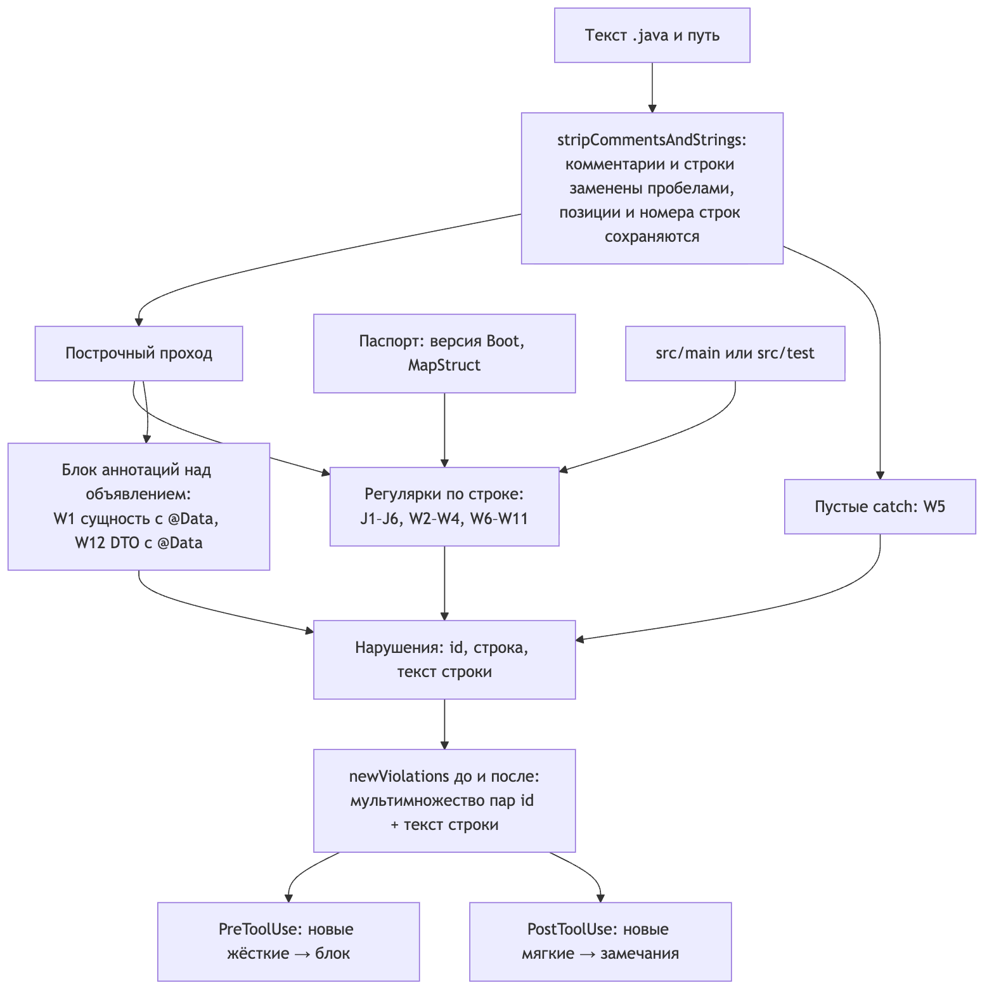

# 04. Правила

Все правила — в `hooks/lib/rules.mjs` (J, W, G, S: текст) и `hooks/lib/guard.mjs` (G, S:
проверка). У каждого правила три части, которые попадают в сообщение модели:
**что не так**, **как исправить**, **пример**.

## Жёсткие: блокируют

| Id | Что ловит | Где действует | Исправление |
|---|---|---|---|
| J1 | `@Autowired` на поле | всё, кроме `src/test/` | `private final` + `@RequiredArgsConstructor` |
| J2 | `import javax.persistence / validation / servlet`, `javax.annotation.PostConstruct` | Boot 3+ по паспорту | тот же API в `jakarta.*` |
| J3 | `System.out`, `System.err`, `printStackTrace()` | `src/main/` | `@Slf4j`, `log.error("...", e)` |
| J4 | `@MockBean`, `@SpyBean` | Boot 4+ по паспорту | `@MockitoBean`, `@MockitoSpyBean` |
| J5 | `import org.junit.Test`, `@RunWith` | везде | JUnit 5: `org.junit.jupiter.api.Test`, `@ExtendWith` |
| J6 | новый `@Disabled` | `src/test/` | починить код или тест, отключать — только с согласия пользователя |
| G1 | изменение существующих строк Liquibase changelog из `main` | `db/changelog/` | новый changeset-файл |
| G2 | правка закоммиченного конфига гейта | `CodeRulesTest*`, `archunit_store/`, `archunit.properties`, `checkstyle*suppress*.xml`, `spotbugs*exclude*.xml` | исправить код, на который ругается правило; правило меняет пользователь |
| S1 | `git push --force`, `git reset --hard`, `git clean -f` | shell | обычный push, `git stash`, или пусть выполнит пользователь |
| S2 | `mvn verify/install/test/deploy` с `-DskipTests` и подобными | shell | запустить без пропуска и починить то, что падает |

## Мягкие: замечания после записи

| Id | Что ловит |
|---|---|
| W1 | `@Data`, `@EqualsAndHashCode`, `@ToString` на `@Entity` (кроме `onlyExplicitlyIncluded = true`) |
| W2 | `@ManyToOne` / `@OneToOne` без `fetch = LAZY` |
| W3 | `@Enumerated` без `EnumType.STRING` |
| W4 | `@Transactional` на `private` или `final` методе |
| W5 | пустой `catch` без комментария |
| W6 | `@SneakyThrows` |
| W7 | конкатенация строк в вызове логгера |
| W8 | класс `*Impl` (кроме `*RepositoryImpl` — так Spring Data требует называть фрагменты) |
| W9 | репозиторий в поле или параметре контроллера |
| W10 | MapStruct `@Mapper` без `unmappedTargetPolicy` и без `config =` |
| W11 | `Optional` как поле или параметр |
| W12 | DTO-класс (`*Dto`, `*Request`, `*Response`) с `@Data`, где подойдёт record |

## Как правила ищутся в коде



1. **Комментарии и строки — пробелами.** `stripCommentsAndStrings` заменяет содержимое
   комментариев, строк, текстовых блоков и символьных литералов пробелами, сохраняя
   длину и переводы строк. `"@Autowired"` в строке или `// System.out` в комментарии не
   нарушение, а номера строк совпадают с исходником.
2. **Построчные регулярки.** Большинство правил — регулярка по строке. J1 смотрит, что
   за аннотацией идёт объявление, кончающееся `;` без скобок: это поле, а не конструктор
   или метод. W2, W3, W10 читают аргументы аннотации до закрывающей скобки, даже если
   они на следующих строках.
3. **Блок аннотаций над объявлением.** Для W1 и W12 хук собирает аннотации над `class` /
   `record` и проверяет, есть ли среди них `@Entity` и `@Data`.
4. **Контекст файла.** Путь (`src/main` / `src/test`) и паспорт (версия Boot, MapStruct)
   включают и выключают правила: J2 только на Boot 3+, J4 только на Boot 4+.
5. **«До» и «после».** Хук всегда сравнивает нарушения файла до записи и после. Ключ
   сравнения — правило + обрезанный текст строки, с учётом повторов. Отсюда главное
   свойство: **блокируется только то, что внесла правка**. Legacy-код не мешает.

Регулярки не видят типов. Всё, что требует знать, что за класс у поля или кто кого
вызывает, живёт в ArchUnit-гейте `java-quality-gates`: он проверяет байткод при сборке.

## Роли файлов

`roles.mjs` определяет роль по аннотациям (`@RestControllerAdvice`, `@RestController`,
`@Entity`, MapStruct `@Mapper`, `@Repository` или `extends JpaRepository`, `@Service`,
`@Configuration`), затем по имени (`*Controller`, `*Service`, `*Repository`, `*Mapper`,
`*Config`, `*Properties`, `*Dto`, `*Request`, `*Response`). Всё в `src/test/` — `test`,
всё в `db/changelog/` — `liquibase`.

| Роль | О чём правила |
|---|---|
| controller | один вызов сервиса, records на входе и выходе, `@Valid`, ошибки через advice |
| service | конкретный класс, `@Transactional` на public, самовызов мимо прокси, DTO на выходе |
| repository | `JpaRepository`, join fetch / `@EntityGraph` против N+1, `Optional` и `Page` |
| entity | `@Getter @Setter`, equals по id, LAZY, `EnumType.STRING`, миграции |
| dto | record, суффиксы, валидация на компонентах |
| mapper | MapStruct с `ReportingPolicy.ERROR` или фабрика в record |
| config | `@ConfigurationProperties` record, таймауты клиентов, профили |
| exception-handler | один advice, `ProblemDetail`, 500 без текста исключения |
| test | JUnit 5 + AssertJ, слайсы, `@MockitoBean` / `@MockBean` по версии |
| liquibase | не править changeset из `main`, один логический change, rollback |

Каждый набор ≤ 120 токенов (проверяет `scripts/check-tokens.mjs`).

## Выключить правило

Правило выключается **только пользователем**, в `forbxpg-java.json` проекта:

```json
{ "disable": ["J3"] }
```

Например, J3 для CLI-утилиты, которая честно пишет в `System.out`. Модели запрещено
править этот файл самой: каждое жёсткое сообщение велит остановиться и спросить.

Дальше: [05. Паспорт, состояние, настройки](05-state-config-passport.md).
