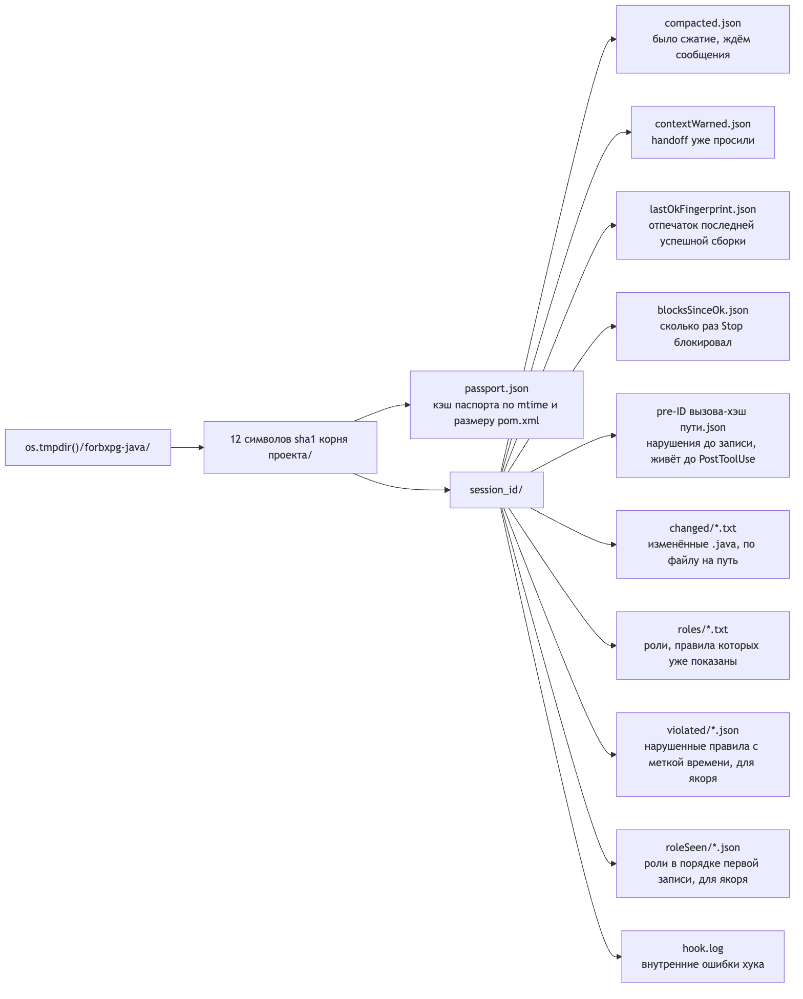

# 05. Паспорт, состояние, настройки

Хук — короткоживущий процесс. Чтобы вести себя разумно, ему нужно знать проект
(паспорт), помнить, что было в сессии (состояние), и учитывать пожелания команды
(настройки). Хуки **никогда не пишут в проект**: всё их хозяйство — во временной папке
ОС.

## Паспорт проекта

`hooks/lib/passport.mjs` читает корневой `pom.xml` и все модули из `<modules>`
рекурсивно. Только регулярками, без запуска Maven.

| Поле | Откуда |
|---|---|
| `java` | `maven.compiler.release`, `java.version`, `maven.compiler.source/target`, `release` — первое найденное, `1.8 → 8` |
| `boot` | `spring-boot-starter-parent` в `<parent>`; иначе свойства `spring-boot.version` / `spring.boot.version`, BOM `spring-boot-dependencies` в любом pom, версия `spring-boot-maven-plugin`. Работает за корпоративным parent и в агрегаторе |
| `lombok`, `mapstruct`, `mapstructBinding` | зависимости |
| `liquibase`, `flyway`, `h2`, `testcontainers` | зависимости |
| `web` | `webmvc`, `webflux`, `feign` |
| `quality` | checkstyle, spotbugs, spotless, errorprone, archunit, jacoco, enforcer |
| `modules`, `wrapper` | `<modules>`, наличие `mvnw` / `mvnw.cmd` |
| `docker` | есть ли сокет Docker (`/var/run/docker.sock` или `\\.\pipe\docker_engine`) |
| `framework` | `quarkus`, `spring`, `jakarta` или `plain` |

Строка паспорта: `Maven · Java 21 · Boot 4.0 · Lombok · MapStruct · Liquibase`. Для
Quarkus и Jakarta EE — `Quarkus: no specific rules`: Spring-правила там неуместны, и
роутер велит следовать коду проекта и брать только `java-language`.

Паспорт кэшируется в `passport.json` по времени изменения и размеру корневого `pom.xml`.
Поменяли `pom.xml` — следующий вызов хука перечитает.

Паспорт влияет на правила: J2 только на Boot 3+, J4 только на Boot 4+, совет про
`@MockitoBean` или `@MockBean` по версии Boot, «Liquibase changeset» или «Flyway
migration» по зависимостям, `./mvnw` или `mvn` в якоре.

## Состояние сессии

`hooks/lib/state.mjs`. Всё лежит в `os.tmpdir()/forbxpg-java/`:



- Папка проекта — первые 12 символов sha1 от пути корня. Разные проекты не мешают друг
  другу.
- Папка сессии — `session_id` от харнесса (символы вне `A-Za-z0-9_.-` заменены на `_`).
  Без `session_id` — `unknown`. Две параллельные сессии в одном проекте не мешают друг
  другу.
- Ключ-значение — отдельный JSON-файл на ключ.
- **Множества** (изменённые файлы, показанные роли) — по файлу-маркеру на элемент,
  созданному с флагом «только если нет». Параллельные вызовы хука (харнесс может
  выполнить несколько записей одновременно) не теряют элементы: нет общего списка,
  который два процесса перезапишут друг за другом.
- **Упорядоченные множества** для якоря (`violated/` — нарушенные правила, `roleSeen/` —
  роли в порядке первой записи) — тоже по файлу на элемент, внутри `{key, at}`. Метка
  `at` всегда больше меток остальных элементов, поэтому порядок сохраняется даже при
  нескольких отметках за одну миллисекунду. Повторное нарушение правила обновляет его
  метку и поднимает его в начало.
- Снимок `pre-*` удаляется в `PostToolUse` сразу после использования.

Временная папка ОС чистится системой; хукам старые сессии не нужны.

## Настройки

`hooks/lib/config.mjs`. Два необязательных файла, проект побеждает по каждому ключу:

1. `forbxpg-java.json` в корне Maven-проекта;
2. `~/.forbxpg-java.json` для всех проектов пользователя;
3. значения по умолчанию.

```json
{
  "anchor": null,
  "stopCompile": true,
  "contextWarnAt": 0.7,
  "disable": []
}
```

| Ключ | По умолчанию | Смысл |
|---|---|---|
| `anchor` | `null` — включён в GigaCode, выключен в Claude Code и Codex | адаптивный якорь на каждое сообщение |
| `stopCompile` | `true` | компилировать в конце хода |
| `contextWarnAt` | `0.7` | при какой заполненности контекста просить handoff (только GigaCode) |
| `disable` | `[]` | id выключенных правил |

Битый JSON в файле настроек равен отсутствию файла: хук не падает.

Дальше: [06. Скиллы и роутер](06-skills.md).
