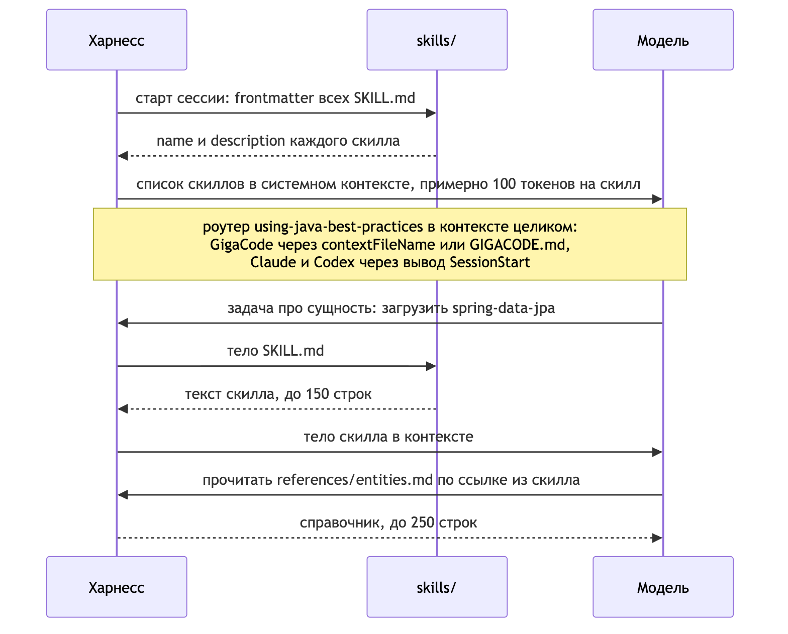

# 06. Скиллы и роутер

## Что такое скилл

Скилл — папка `skills/<имя>/` по спецификации [Agent Skills](https://agentskills.io):

```text
skills/spring-data-jpa/
├── SKILL.md                  # frontmatter + основной текст (≤ 150 строк)
└── references/               # справочники (≤ 250 строк каждый), читаются по ссылке
    ├── entities.md
    ├── liquibase.md
    └── queries-and-n-plus-1.md
```

`SKILL.md` начинается с frontmatter:

```yaml
---
name: spring-data-jpa
description: JPA / Hibernate entities, Spring Data repositories, queries and schema changes with Liquibase. Use when creating or changing an @Entity or repository, ...
---
```

`name` — идентификатор. `description` — **единственное**, что модель видит о скилле до
его загрузки. По нему она решает, грузить ли скилл. Поэтому описание говорит не «что
внутри», а «когда использовать»: перечисляет задачи и слова, с которыми придёт
пользователь.

## Как харнесс подгружает скиллы



Три уровня, от дешёвого к дорогому:

1. **Каталог** — имя и описание каждого скилла, в контексте всегда. Около 100 токенов на
   скилл.
2. **Тело `SKILL.md`** — загружается, когда модель решила, что скилл нужен (Claude Code —
   инструмент Skill, GigaCode и Codex — свои механизмы активации).
3. **Справочники `references/`** — модель читает файл, только когда тело скилла на него
   ссылается и задача этого требует.

Так в контексте лежит только то, что нужно для текущей задачи.

Где харнесс ищет скиллы:

| Харнесс | Плагин / расширение | Проект | Пользователь |
|---|---|---|---|
| Claude Code | `skills/` плагина | `.claude/skills/` | `~/.claude/skills/` |
| GigaCode | `skills/` расширения | `.gigacode/skills/` | `~/.gigacode/skills/` |
| Codex | `skills` в `.codex-plugin/plugin.json` | — | `~/.agents/skills/` |

## Роутер

`using-java-best-practices` — особый скилл. Его не нужно «выбирать»: он **всегда целиком в
контексте**:

- GigaCode — `contextFileName` в `gigacode-extension.json` или строка
  `@.gigacode/skills/using-java-best-practices/SKILL.md` в `GIGACODE.md` при установке в
  проект;
- Claude Code и Codex — хук `SessionStart` печатает его текст после паспорта.

Внутри:

1. **13 правил, которые действуют всегда**: какой скилл грузить первым, пакеты по слоям,
   сервисы без `*Impl`, внедрение через конструктор, DTO-records, сущности без `@Data`,
   MapStruct, ProblemDetail, Liquibase, логирование, тесты, маленькие шаги, «готово»
   только с выводом сборки.
2. **Таблица «какой скилл когда»** — маршрутизация по этапам работы.
3. **Что делают хуки** — чтобы модель понимала отказ и не пыталась его обойти.
4. **Работа с пользователем** — следовать коду проекта, не переписывать legacy без
   просьбы, не обходить хук.

Бюджет роутера — 1500 токенов (`scripts/check-tokens.mjs`): он платится в каждой сессии.

## Десять скиллов

| Скилл | Когда грузится |
|---|---|
| `using-java-best-practices` | всегда (роутер) |
| `java-design-decisions` | планирование, гриль, спека, план изменения до кода |
| `java-conventions` | новый класс, пакет, модуль, проект; именование, Lombok, DTO и маппинг, конфигурация |
| `java-language` | чистая Java 21 / 25: records, sealed, patterns, Optional, исключения, коллекции, конкурентность |
| `spring-boot-service` | контроллеры, валидация, ошибки, сервисы и транзакции, прокси, HTTP-клиенты, `@Async`, `@Scheduled` |
| `spring-data-jpa` | сущности, репозитории, запросы, N+1, блокировки, Liquibase |
| `java-testing` | писать или чинить тесты, покрытие, флаки |
| `java-code-review` | ревью кода, диффа, PR |
| `java-verification` | перед любым «компилируется», «тесты прошли», «готово» |
| `java-quality-gates` | поставить ArchUnit, Enforcer, JaCoCo в проект |

## Как скиллы и хуки дополняют друг друга

- Скилл говорит **как писать** и **почему**. Хук проверяет **результат**.
- Текст сообщения хука (что не так, как исправить, пример) совпадает со скиллом. Модель,
  получив отказ, получает и готовое решение — ей не нужно искать его в скилле.
- Роль файла в `PostToolUse` — это выжимка нужного раздела скилла ровно в момент, когда
  модель пишет файл этой роли.
- Блок восстановления после сжатия повторяет главные правила роутера: сжатие могло
  выбросить его из контекста.

## Проверки скиллов

`scripts/validate-skills.mjs` (в CI):

- frontmatter по спецификации Agent Skills, допустимые ключи;
- имя подходит и спецификации (`a-z0-9-`), и GigaCode;
- `SKILL.md` ≤ 150 строк, справочники ≤ 250;
- все ссылки на `references/` существуют;
- у каждого скилла ≥ 2 кейса в `evals/routing.tsv`.

`scripts/eval-routing.mjs` — проверка маршрутизации: модели дают только имена и
описания и спрашивают, какой скилл грузить для запроса из `evals/routing.tsv`. Нужен
OpenAI-совместимый endpoint, в CI не запускается.

Дальше: [07. Установка изнутри](07-installation.md).
