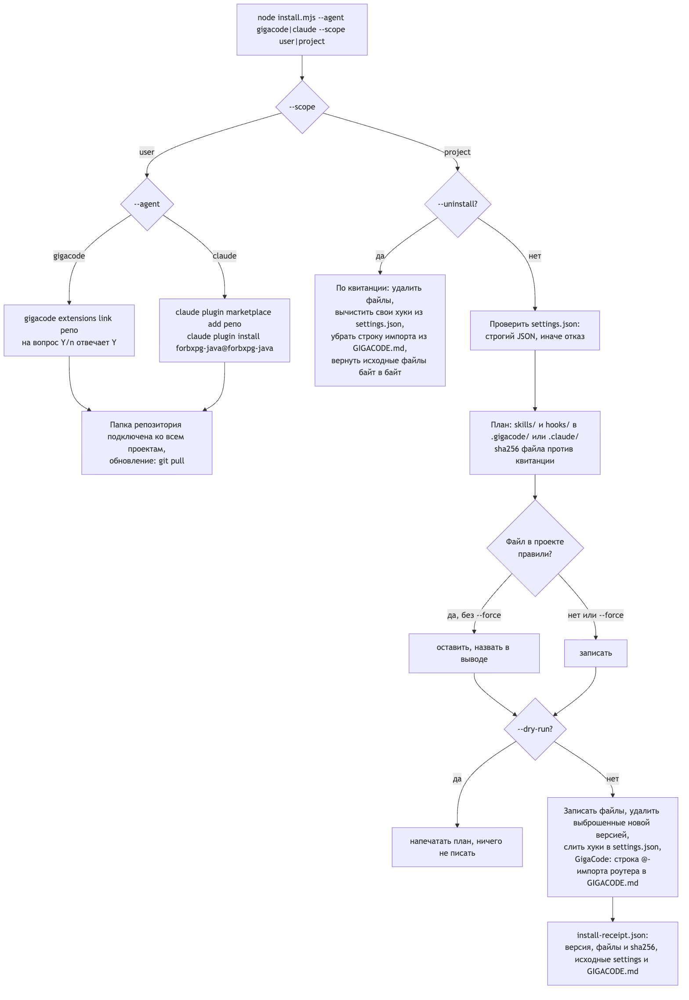

# 07. Установка изнутри

`install.mjs` — тонкая обёртка: разбирает аргументы и вызывает `installer/user.mjs` или
`installer/project.mjs`.

## User scope: для себя, во все проекты

Установщик ничего не копирует сам — он вызывает CLI агента, который регистрирует **папку
репозитория** как плагин или расширение:

| Агент | Установка | Удаление |
|---|---|---|
| GigaCode | `gigacode extensions link <репо>` с ответом `Y` | `gigacode extensions uninstall forbxpg-java` |
| Claude Code | `claude plugin marketplace add <репо>`, `claude plugin install forbxpg-java@forbxpg-java` | `claude plugin uninstall ...`, `claude plugin marketplace remove forbxpg-java` |

- Для GigaCode именно `link`, не `install`: `install` видит `.claude-plugin/` и ставит
  папку как плагин Claude, теряя контекст-файл и хуки.
- `link` спрашивает «Do you want to continue? [Y/n]» и без ответа в неинтерактивной
  оболочке молча ничего не ставит. Установщик передаёт `Y` в stdin.
- Обновление — `git pull` в папке репозитория: харнесс читает файлы прямо из неё.
- На Windows `gigacode.cmd` и `claude.cmd` запускаются через shell.

## Project scope: в репозиторий, для всей команды

Скиллы и хуки **копируются в репозиторий** и коммитятся. Каждый разработчик получает их
через git, ничего не устанавливая.

| | GigaCode | Claude Code |
|---|---|---|
| Скиллы | `.gigacode/skills/` | `.claude/skills/` |
| Код хуков | `.gigacode/forbxpg-java/hooks/` | `.claude/forbxpg-java/hooks/` |
| Регистрация | `.gigacode/settings.json` | `.claude/settings.json` |
| Команда | `node .gigacode/forbxpg-java/hooks/java-hooks.mjs <Event> --harness gigacode` | `node "$CLAUDE_PROJECT_DIR/.claude/forbxpg-java/hooks/java-hooks.mjs" <Event> --harness claude` |
| Роутер | строка `@`-импорта в `GIGACODE.md` | печатает хук `SessionStart` |
| Квитанция | `.gigacode/forbxpg-java/install-receipt.json` | `.claude/forbxpg-java/install-receipt.json` |

### Установка

1. **Проверка до первой записи.** `settings.json` должен быть строгим JSON. С
   комментариями или висячими запятыми установка откажет и ничего не тронет: такой файл
   нельзя перезаписать, не потеряв комментарии.
2. **План.** Каждый файл из `skills/` и `hooks/` сравнивается с квитанцией прошлой
   установки по sha256. Файл, который команда правила в проекте, **не перезаписывается**
   без `--force` и называется в выводе.
3. `--dry-run` — напечатать план и выйти.
4. **Запись.** Копирует файлы. Удаляет файлы, которых нет в новой версии, если их не
   правили.
5. **Слияние `settings.json`.** Свои записи хук узнаёт по `forbxpg-java` в команде.
   Старые свои записи удаляются, новые добавляются **после** чужих. Чужие ключи и хуки
   других инструментов не трогаются.
6. **GigaCode: `GIGACODE.md`.** Добавляет строку импорта роутера, если её ещё нет.
7. **Квитанция:** версия, файлы с sha256, был ли создан `.gigacode/` / `.claude/`, исходный
   текст `settings.json` и `GIGACODE.md` до первой установки.

Повторная установка и `--update` — одна и та же операция: установка идемпотентна.

### Удаление (`--uninstall`)

По квитанции, и только то, что в ней:

1. Удаляет файлы из квитанции и опустевшие папки.
2. Вычищает свои хуки из `settings.json`. Если файла до установки не было и в нём не
   осталось чужих настроек — удаляет файл. Если был и остался прежним по смыслу —
   восстанавливает **исходный текст байт в байт**. Ключ `"$version"`, который GigaCode сам
   дописывает в `settings.json`, при этом не считается настройкой команды.
3. Убирает строку импорта из `GIGACODE.md` и восстанавливает исходный файл или удаляет
   его, если он был создан установкой.
4. Удаляет квитанцию и `.gigacode/` / `.claude/`, если установка их создала.

Итог проверен тестом: установка и удаление оставляют проект ровно таким, каким он был.

### Что важно для команды

- Результат установки коммитится.
- GigaCode запускает хук проекта по пути от корня проекта и не читает
  `.gigacode/settings.json` родительской папки, если сессия открыта в подпапке.
  Открывайте сессии в корне репозитория.
- Две установки (GigaCode и Claude Code) живут в одном репозитории независимо: удаление
  одной не трогает другую.

Дальше: [08. Различия харнессов](08-harnesses.md).
